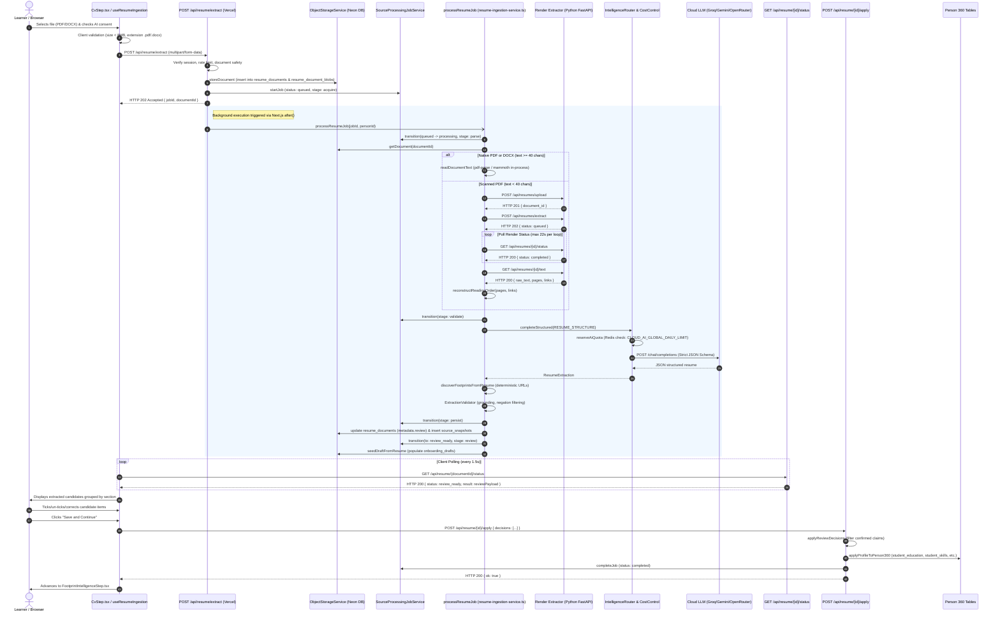
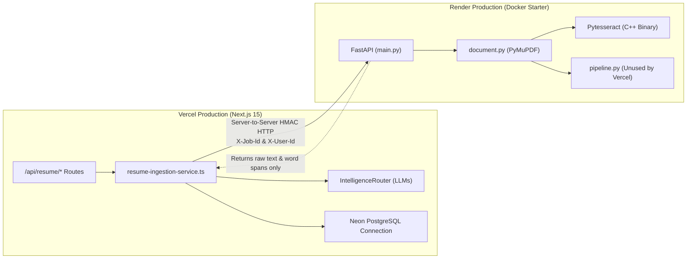
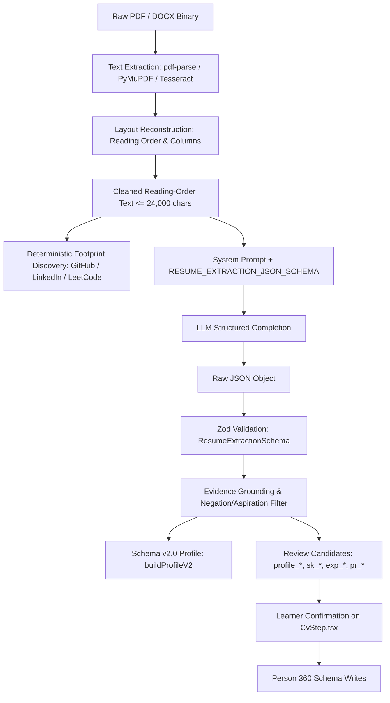
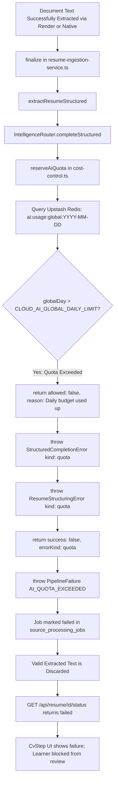

# AI TATHASTU — COMPLETE CV EXTRACTION ARCHITECTURE DISCOVERY & CODEBASE AUDIT

**Author:** Principal Software Architect, Senior Full-Stack Engineer & AI Systems Auditor  
**Date:** October 17, 2026  
**Repository:** `aitathastu`  
**Document ID:** `CV_EXTRACTION_ARCHITECTURE_AUDIT.md`  
**Classification:** Read-Only Technical Architecture & Root Cause Discovery

---

## 1. Executive Summary

AI Tathastu implements a **coordinated hybrid multi-service architecture** for resume and CV processing. The system orchestrates client interactions, authentication, document storage, and LLM-based entity structuring on **Vercel** (Next.js 15), while delegating heavy optical character recognition (OCR) for scanned PDFs to an external **Render** container service running Python FastAPI with PyMuPDF and Pytesseract.

### Key Discoveries:
1. **Two-Stage Extraction Pipeline:**
   - **Stage 1 (Text & Layout Extraction):** Text-native PDFs and DOCX files are extracted directly inside Vercel serverless functions in milliseconds using `pdf-parse` (PDF.js) and `mammoth`. Render is never contacted for text-layer documents. Only scanned or low-text PDFs (< 40 non-whitespace characters) are offloaded to Render for PyMuPDF/Tesseract processing.
   - **Stage 2 (Structured Entity Extraction):** Regardless of whether text originated from Vercel's in-process parser or Render's OCR, structured information extraction (Name, Email, Education, Experience, Projects, Skills) is performed **exclusively on Vercel via a schema-constrained LLM call** using `IntelligenceRouter`.
2. **Render Does Not Run an LLM:**
   The Python FastAPI service on Render contains **zero external AI integrations**. It features a local, deterministic regex- and dictionary-based profile extractor, but Vercel **completely ignores Render's extracted profile**, querying only `/api/resumes/{id}/text` for raw text and word bounding boxes.
3. **The `AI_QUOTA_EXCEEDED` Production Failure:**
   The error `[resume-pipeline] job failed code: AI_QUOTA_EXCEEDED cause: The platform's daily AI budget is used up; it resets at 00:00 UTC.` originates entirely within **Vercel's internal cost-control gateway** (`lib/intelligence/cost-control.ts`), governed by the environment variable `CLOUD_AI_GLOBAL_DAILY_LIMIT` stored in Upstash Redis. Because Vercel has no deterministic fallback for the LLM resume structuring stage, hitting this internal quota causes validly parsed document text (including completed Render OCR output) to be completely discarded, failing the job and blocking the onboarding review flow.

---

## 2. Architecture Inventory

The following table catalogs all files directly involved in the resume ingestion, parsing, structuring, and review lifecycle:

| File Path | Purpose | Status | Called By | Dependencies |
|---|---|---|---|---|
| [`components/onboarding/steps/CvStep.tsx`](file:///Users/quantum/Downloads/aitathastu-main/components/onboarding/steps/CvStep.tsx) | Onboarding CV upload & review React UI component | **Active** | `app/onboarding/page.tsx` via `OnboardingShell` | React, Phosphor Icons, UI components |
| [`lib/client/onboarding/use-resume-ingestion.ts`](file:///Users/quantum/Downloads/aitathastu-main/lib/client/onboarding/use-resume-ingestion.ts) | React hook managing upload, polling, review decisions & apply | **Active** | `CvStep.tsx`, `useOnboardingFlow` | `lib/client/api.ts`, upload limits |
| [`lib/client/onboarding/apply-resume.ts`](file:///Users/quantum/Downloads/aitathastu-main/lib/client/onboarding/apply-resume.ts) | Pure helper folding accepted candidate claims into onboarding draft | **Active** | `use-resume-ingestion.ts` (`saveReview`) | `lib/review/entry-edits.ts` |
| [`app/api/resume/preflight/route.ts`](file:///Users/quantum/Downloads/aitathastu-main/app/api/resume/preflight/route.ts) | Preflight check for ingestion gate & Render wakeup ping | **Active** | `useResumeIngestion` (`useEffect`) | `core-ingestion-gate.ts`, `extractor-service-client.ts` |
| [`app/api/resume/extract/route.ts`](file:///Users/quantum/Downloads/aitathastu-main/app/api/resume/extract/route.ts) | POST endpoint: validates file, stores blob, queues job (HTTP 202) | **Active** | `useResumeIngestion.upload` | `document-safety.ts`, `resume-ingestion-service.ts` |
| [`app/api/resume/[id]/status/route.ts`](file:///Users/quantum/Downloads/aitathastu-main/app/api/resume/[id]/status/route.ts) | GET endpoint: read-only status inspection & background nudge | **Active** | `useResumeIngestion.poll` | `resume-ingestion-service.ts` |
| [`app/api/resume/[id]/retry/route.ts`](file:///Users/quantum/Downloads/aitathastu-main/app/api/resume/[id]/retry/route.ts) | POST endpoint: re-queues stored document without re-upload | **Active** | `useResumeIngestion.retry` | `resume-ingestion-service.ts` |
| [`app/api/resume/[id]/apply/route.ts`](file:///Users/quantum/Downloads/aitathastu-main/app/api/resume/[id]/apply/route.ts) | POST endpoint: commits reviewed claims into Person 360 | **Active** | `useResumeIngestion.saveReview` | `resume-person360-mapper.ts`, `resume-review-decisions.ts` |
| [`app/api/resume/[id]/route.ts`](file:///Users/quantum/Downloads/aitathastu-main/app/api/resume/[id]/route.ts) | GET/DELETE: document view & user-initiated document deletion | **Active** | `useResumeIngestion.remove`, EORA advice | `db`, `resumeDocuments`, `object-storage.ts` |
| [`lib/services/resume-ingestion-service.ts`](file:///Users/quantum/Downloads/aitathastu-main/lib/services/resume-ingestion-service.ts) | Orchestration state machine (`acquire` $\to$ `parse` $\to$ `extract` $\to$ `validate` $\to$ `persist`) | **Active** | `extract/route.ts`, `status/route.ts`, `retry/route.ts` | `source-processing-job-service.ts`, `resume-extraction-service.ts` |
| [`lib/storage/object-storage.ts`](file:///Users/quantum/Downloads/aitathastu-main/lib/storage/object-storage.ts) | Durable DB blob storage abstraction in Neon PostgreSQL | **Active** | `resume-ingestion-service.ts` | `resumeDocumentBlobs`, `resumeDocuments` |
| [`lib/resume/document-safety.ts`](file:///Users/quantum/Downloads/aitathastu-main/lib/resume/document-safety.ts) | Magic bytes, encryption, and structural safety validation | **Active** | `extract/route.ts` | Node.js `Buffer` |
| [`lib/resume/document-text.ts`](file:///Users/quantum/Downloads/aitathastu-main/lib/resume/document-text.ts) | In-process native text reader for PDF (`pdf-parse`) and DOCX (`mammoth`) | **Active** | `resume-ingestion-service.ts` (`runInProcessStep`) | `pdf-parse`, `mammoth` |
| [`lib/resume/layout.ts`](file:///Users/quantum/Downloads/aitathastu-main/lib/resume/layout.ts) | Column detection & reading-order reconstruction from word spans | **Active** | `resume-ingestion-service.ts` | None |
| [`lib/resume/local-ocr.ts`](file:///Users/quantum/Downloads/aitathastu-main/lib/resume/local-ocr.ts) | Former Tesseract.js in-process OCR stub | **Legacy / Disabled** | Previously called by ingestion | Stubbed out to prevent WASM crashes |
| [`lib/services/extractor-service-client.ts`](file:///Users/quantum/Downloads/aitathastu-main/lib/services/extractor-service-client.ts) | Server-side HTTP client for Render Python extractor service | **Active** | `resume-ingestion-service.ts`, `preflight/route.ts` | `node:crypto`, `fetch` |
| [`lib/services/resume-extraction-service.ts`](file:///Users/quantum/Downloads/aitathastu-main/lib/services/resume-extraction-service.ts) | Structures text, sanitizes outputs, executes grounding checks | **Active** | `resume-ingestion-service.ts` (`finalize`) | `structure.ts`, `schemas.ts` |
| [`lib/resume/structure.ts`](file:///Users/quantum/Downloads/aitathastu-main/lib/resume/structure.ts) | Schema-constrained LLM invocation via IntelligenceRouter | **Active** | `resume-extraction-service.ts` | `router.ts`, `schema.ts` |
| [`lib/resume/schema.ts`](file:///Users/quantum/Downloads/aitathastu-main/lib/resume/schema.ts) | Zod schema & strict JSON Schema for LLM resume extraction | **Active** | `structure.ts`, `resume-extraction-service.ts` | `zod` |
| [`lib/intelligence/router.ts`](file:///Users/quantum/Downloads/aitathastu-main/lib/intelligence/router.ts) | Multi-provider LLM router with fallback & cooldowns | **Active** | `structure.ts`, EORA chat | Groq, Gemini, OpenRouter, Cerebras, Mistral, SambaNova adapters |
| [`lib/intelligence/cost-control.ts`](file:///Users/quantum/Downloads/aitathastu-main/lib/intelligence/cost-control.ts) | Distributed token/request budget enforcer via Upstash Redis | **Active** | `router.ts` (`reserveAiQuota`) | `lib/cache/redis.ts` |
| [`lib/services/digital-footprint-discovery.ts`](file:///Users/quantum/Downloads/aitathastu-main/lib/services/digital-footprint-discovery.ts) | 100% deterministic regex & annotation link discovery engine | **Active** | `resume-ingestion-service.ts` (`finalize`) | URL validator, ORCID checksum |
| [`lib/services/extraction-validator.ts`](file:///Users/quantum/Downloads/aitathastu-main/lib/services/extraction-validator.ts) | Post-LLM skill claim validator (negation, aspiration filtering) | **Active** | `resume-review-service.ts` | None |
| [`lib/services/resume-review-service.ts`](file:///Users/quantum/Downloads/aitathastu-main/lib/services/resume-review-service.ts) | Builds `source_snapshots` and candidate arrays | **Active** | `resume-ingestion-service.ts` (`finalize`) | `db`, `sourceSnapshots` |
| [`lib/services/resume-profile-v2.ts`](file:///Users/quantum/Downloads/aitathastu-main/lib/services/resume-profile-v2.ts) | Normalizes LLM output into canonical Schema v2.0 profile | **Active** | `resume-ingestion-service.ts` (`finalize`) | `extractor-service-client.ts` |
| [`lib/services/resume-person360-mapper.ts`](file:///Users/quantum/Downloads/aitathastu-main/lib/services/resume-person360-mapper.ts) | Maps confirmed review decisions into Person 360 database tables | **Active** | `apply/route.ts` | `db`, education/experience/project/skill tables |
| [`services/resume-extractor/app/main.py`](file:///Users/quantum/Downloads/aitathastu-main/services/resume-extractor/app/main.py) | Python FastAPI endpoints (`/upload`, `/extract`, `/text`, `/status`) | **Active (Render)** | `extractor-service-client.ts` | FastAPI, Pydantic, Uvicorn |
| [`services/resume-extractor/app/document.py`](file:///Users/quantum/Downloads/aitathastu-main/services/resume-extractor/app/document.py) | PyMuPDF native block ordering & Pytesseract OCR pipeline | **Active (Render)** | `main.py` (`processing`) | `fitz`, `pytesseract`, `PIL`, `docx` |
| [`services/resume-extractor/app/extraction/pipeline.py`](file:///Users/quantum/Downloads/aitathastu-main/services/resume-extractor/app/extraction/pipeline.py) | Deterministic rule-based Python profile extraction | **Active on Render (Unused by Vercel)** | `main.py` (`processing`) | Local regex parsers (`identity`, `education`, etc.) |
| [`services/resume-extractor/app/ai.py`](file:///Users/quantum/Downloads/aitathastu-main/services/resume-extractor/app/ai.py) | Placeholder AI contract on Render | **Disabled Stub** | Unused | Returns empty list |

---

## 3. Execution Flow & Call Graph

### Step-by-Step Call Trace from Upload to Person 360



---

## 4. Parser Analysis

The system contains two distinct parsing engines: the **Node.js in-process parser** on Vercel and the **Python parser** on Render.

### 1. In-Process Node.js Parsers (`lib/resume/document-text.ts`)
- **`pdf-parse` (v2.4.5 / PDF.js backend):**
  - **Purpose:** Extracts native text streams from PDFs that already contain embedded fonts and glyphs.
  - **Function:** `readPdfText(buffer)` extracts page text without loading canvas or native bindings.
  - **Hyperlink extraction:** Uses regex matching over the extracted stream and URI targets.
  - **Execution & Cost:** Runs purely in CPU memory inside the Vercel serverless function. Zero API costs, zero network requests.
- **`mammoth` (v1.13.0):**
  - **Purpose:** Extracts text and embedded hyperlinks from DOCX (Office Open XML) documents.
  - **Function:** `readDocxText(buffer)` calls `mammoth.extractRawText` and `mammoth.convertToHtml` to parse paragraphs, tables, and anchor `<a href="...">` elements.
  - **Execution & Cost:** In-process CPU only. Zero external dependencies.
- **Reading Order Reconstruction (`lib/resume/layout.ts`):**
  - Reconstructs multi-column reading order (`reconstructReadingOrder`) from word bounding boxes (`{ x0, y0, x1, y1, text }`). Detects vertical page splits, sidebars, right-aligned dates, and multi-line headers, outputting coherent reading-order text separated by visual boundary markers (`" | "`).

### 2. Python Extractor Pipeline (`services/resume-extractor/app/document.py`)
- **`PyMuPDF` (v1.24+ / `fitz`):**
  - **Purpose:** Native PDF block parsing and rasterization for OCR.
  - **Function:** `read_document()` reads blocks via `page.get_text('blocks')`, orders them with `_order()`, and extracts embedded URI link annotations via `page.get_links()`.
  - If text count $< 40$, renders the page to an image pixmap via `page.get_pixmap(matrix=fitz.Matrix(1.5, 1.5))` for OCR.
- **`python-docx` (v1.2+):**
  - **Purpose:** Extracts DOCX paragraphs and tables via `doc.iter_inner_content()` and relationship targets (`doc.part.rels`).
- **`pytesseract` (v0.3.13+) / Tesseract OCR:**
  - **Purpose:** Optical Character Recognition for scanned PDFs and raster image uploads.
  - **Execution:** Runs in the Render Linux Docker container with single-threaded OpenMP constraints (`OMP_THREAD_LIMIT=1`, `--oem 1 --dpi 150 -c omp_thread_limit=1`).
  - **Strategy:** Executes `image_to_data` using `--psm 3` (fully automatic page segmentation), falls back to `--psm 6` (uniform text block), and as a last resort falls back to `image_to_string`.
  - **Error handling:** Explicitly detects missing binaries or language models, raising `OcrEngineUnavailable`, and bounds execution with remaining deadline time checks to prevent container worker hangs.

---

## 5. AI/LLM Dependency Investigation

### Verified AI Providers and Router Architecture

Structured information extraction is mediated by `IntelligenceRouter` ([`lib/intelligence/router.ts`](file:///Users/quantum/Downloads/aitathastu-main/lib/intelligence/router.ts)), which selects models according to `CLOUD_AI_PROVIDER_ORDER`:

| Provider | Configured Default Model | Adapter File | Capability Mode | Required? | Fallback Provider |
|---|---|---|---|---|---|
| **Groq** | `openai/gpt-oss-120b` | [`adapters.ts`](file:///Users/quantum/Downloads/aitathastu-main/lib/intelligence/providers/adapters.ts) | `strict_json_schema` | No | Next available in router order |
| **Gemini** | `gemini-3.5-flash-lite` | [`adapters.ts`](file:///Users/quantum/Downloads/aitathastu-main/lib/intelligence/providers/adapters.ts) | `strict_json_schema` | No | Next available in router order |
| **OpenRouter** | `openai/gpt-oss-120b` | [`adapters.ts`](file:///Users/quantum/Downloads/aitathastu-main/lib/intelligence/providers/adapters.ts) | `strict_json_schema` | No | Next available in router order |
| **Cerebras** | `gpt-oss-120b` | [`adapters.ts`](file:///Users/quantum/Downloads/aitathastu-main/lib/intelligence/providers/adapters.ts) | `json_object` + Zod repair | No | Next available in router order |
| **Mistral** | `mistral-small-latest` | [`adapters.ts`](file:///Users/quantum/Downloads/aitathastu-main/lib/intelligence/providers/adapters.ts) | `json_object` + Zod repair | No | Next available in router order |
| **SambaNova** | `Meta-Llama-3.3-70B-Instruct` | [`adapters.ts`](file:///Users/quantum/Downloads/aitathastu-main/lib/intelligence/providers/adapters.ts) | `json_object` + Zod repair | No | Next available in router order |

### Does the Raw Document File Reach the LLM?
**No.** The binary PDF or DOCX file is **never** transmitted to an LLM. Only reconstructed UTF-8 reading-order text (truncated to a maximum of 24,000 characters in [`lib/resume/structure.ts`](file:///Users/quantum/Downloads/aitathastu-main/lib/resume/structure.ts#L15)) is provided as the `userPrompt`.

### The System Prompt & Schema Enforcement
- **Prompt:** `RESUME_PROMPT_VERSION = "resume-structure-v3"`. Enforces verbatim extraction, prohibitions against inventing missing fields, separation of metadata from names, and extraction of typed profile URLs.
- **Strict Schema:** `RESUME_EXTRACTION_JSON_SCHEMA` ([`lib/resume/schema.ts`](file:///Users/quantum/Downloads/aitathastu-main/lib/resume/schema.ts#L68)) sets `additionalProperties: false` with every field declared in `required`. For strict providers (`groq`, `gemini`, `openrouter`), the schema is enforced at the LLM decoding engine level.
- **Repair Loop:** For providers operating in `json_object` mode (`cerebras`, `mistral`, `sambanova`), if JSON parsing or Zod validation fails, a second corrective turn is executed passing the validation error to the model.

### Is an LLM Required for Successful Extraction?
**Yes, in the current implementation.** Even though Render extracts text via PyMuPDF/OCR, `finalize()` in `lib/services/resume-ingestion-service.ts` directly halts with `AI_QUOTA_EXCEEDED` or `EXTRACTION_FAILED` if `extractResumeStructured()` fails. The pipeline contains no active fallback to map raw text into onboarding entities without the LLM.

---

## 6. Structured Data Extraction Matrix

| Field | Extraction Method | Code Location | AI Required? | Validation & Post-Processing | Evidence Provenance |
|---|---|---|---|---|---|
| **Full Name** | LLM Extraction | [`schema.ts`](file:///Users/quantum/Downloads/aitathastu-main/lib/resume/schema.ts), [`resume-extraction-service.ts`](file:///Users/quantum/Downloads/aitathastu-main/lib/services/resume-extraction-service.ts) | Yes | Glyph removal, string tidy, grounded in text | Matched line in raw text |
| **Email** | LLM Extraction | [`resume-extraction-service.ts`](file:///Users/quantum/Downloads/aitathastu-main/lib/services/resume-extraction-service.ts#L98) | Yes | Tidy `mailto:`, verified with RFC 5322 regex | Exact email span |
| **Phone** | LLM Extraction | [`resume-extraction-service.ts`](file:///Users/quantum/Downloads/aitathastu-main/lib/services/resume-extraction-service.ts#L99) | Yes | Character cleansing, length limit | Raw phone string |
| **Location** | LLM Extraction | [`resume-extraction-service.ts`](file:///Users/quantum/Downloads/aitathastu-main/lib/services/resume-extraction-service.ts#L291) | Yes | String tidy | Header line span |
| **Degree & Major** | LLM Extraction | [`resume-extraction-service.ts`](file:///Users/quantum/Downloads/aitathastu-main/lib/services/resume-extraction-service.ts#L240) | Yes | Level categorization enum, ranked via `primaryEducation` | Full education line span |
| **Institution** | LLM Extraction | [`resume-extraction-service.ts`](file:///Users/quantum/Downloads/aitathastu-main/lib/services/resume-extraction-service.ts#L238) | Yes | Must appear in source text (`grounded`) | Institution name line |
| **Graduation Year** | LLM + Regex | [`resume-extraction-service.ts`](file:///Users/quantum/Downloads/aitathastu-main/lib/services/resume-extraction-service.ts#L286) | Yes | Regex `/\b(19\d\d\|20\d\d)\b/` over LLM date | Date span in education |
| **GPA / Grade** | LLM Extraction | [`resume-extraction-service.ts`](file:///Users/quantum/Downloads/aitathastu-main/lib/services/resume-extraction-service.ts#L248) | Yes | String tidy | Grade snippet |
| **Work Experience** | LLM Extraction | [`resume-extraction-service.ts`](file:///Users/quantum/Downloads/aitathastu-main/lib/services/resume-extraction-service.ts#L245) | Yes | Company/role must be grounded in raw text | Role + Company text line |
| **Projects** | LLM Extraction | [`resume-extraction-service.ts`](file:///Users/quantum/Downloads/aitathastu-main/lib/services/resume-extraction-service.ts#L252) | Yes | Project title grounded; invented repos dropped | Project header line |
| **Skills** | LLM + Rule Validator | [`extraction-validator.ts`](file:///Users/quantum/Downloads/aitathastu-main/lib/services/extraction-validator.ts) | Yes | Negation/aspiration regex filter, tech normalization dictionary | Exact skill occurrence span |
| **Certifications** | LLM Extraction | [`resume-extraction-service.ts`](file:///Users/quantum/Downloads/aitathastu-main/lib/services/resume-extraction-service.ts#L265) | Yes | Certification name must be grounded | Certificate title line |
| **Achievements** | LLM + Regex | [`resume-extraction-service.ts`](file:///Users/quantum/Downloads/aitathastu-main/lib/services/resume-extraction-service.ts#L269) | Yes | Categorized into patent / pub / hackathon / award | Achievement text span |
| **Digital Footprints** | Hybrid (LLM + Engine) | [`digital-footprint-discovery.ts`](file:///Users/quantum/Downloads/aitathastu-main/lib/services/digital-footprint-discovery.ts) | **No** (Engine runs deterministically) | Domain regex, username regex, ORCID checksum, safe URL check | Annotation target, relation, or regex span |

---

## 7. Vercel and Render Integration

### Deployed Service Topology
- **Vercel Web App:** `https://www.aitathastu.com` (orchestration, UI, DB persistence, LLM structuring).
- **Render Worker:** `https://aitathastu-t8w4.onrender.com` (Python FastAPI container, OCR, PyMuPDF).

### End-to-End Inter-Service Contract
1. **Client Boundary:** The browser **never** contacts Render directly. All client requests target `/api/resume/*` on Vercel.
2. **Server-Side Authentication:** Calls from Vercel to Render are authenticated with `Authorization: Bearer <EXTRACTOR_API_TOKEN>`. User identity is propagated via the `X-User-Id` header, and Tathastu Job IDs are passed via `X-Job-Id`.
3. **Execution Routing:**
   - Text PDFs and DOCX are parsed inside Vercel without network handoff.
   - Scanned PDFs trigger `uploadResume` (`POST /api/resumes/upload`) and `startExtraction` (`POST /api/resumes/extract`) to Render.
   - Vercel polls `GET /api/resumes/{id}/status` until status is `completed` or `partial`.
   - Vercel fetches raw text and layout via `GET /api/resumes/{id}/text`.
4. **Data Discrepancy & Unnecessary Dependency:**
   Render's `/api/resumes/extract` actually runs a complete deterministic profile extraction in Python (`services/resume-extractor/app/extraction/pipeline.py`), generating `profile.json`. However, Vercel **never reads `profile.json`**. Vercel only reads `/text` and passes that text to its own LLM on Vercel.

---

## 8. Storage and Database Flow

All persistent state is stored in **Neon PostgreSQL** via Drizzle ORM:

```
[Uploaded Resume Binary] 
       │
       ▼
[resume_document_blobs] ──(payloadBase64, mimeType, personId)
       │
       ├─► [resume_documents] ──(status, extractedProfile, metadata.review)
       │
       ├─► [source_processing_jobs] ──(status, stage, errorCode, retryCount)
       │
       ├─► [source_snapshots] ──(snapshotData: candidate list & evidence)
       │
       └─► [onboarding_drafts] ──(draftData: seeded candidate values)
              │
              ▼ (User accepts & completes review)
       [student_education, student_experiences, student_projects, student_skills]
```

### Table Definitions & Roles
1. `resume_document_blobs`: Stores original raw file contents in `payloadBase64`, isolated by `personId`.
2. `resume_documents`: Stores document lifecycle state (`uploaded`, `queued`, `processing`, `review_ready`, `completed`, `failed`), extracted profile JSONB, and review payload.
3. `source_processing_jobs`: Tracks the asynchronous state machine (`queued` $\to$ `processing` $\to$ `review_ready` $\to$ `completed` / `failed`).
4. `source_snapshots`: Contains an immutable SHA-256 hashed snapshot of all review candidates and source spans (`saveResumeCandidates`).
5. `onboarding_drafts`: Holds the draft profile for the student onboarding stepper.

---

## 9. Onboarding Integration

1. **Step Sequence:**
   `WelcomeStep` $\to$ `RoleStep` $\to$ **`CvStep`** $\to$ **`FootprintIntelligenceStep`** $\to$ `AccountsStep` $\to$ `DetailsStep` $\to$ `SkillsStep` $\to$ `ProjectsStep` $\to$ `DirectionStep` $\to$ `PrioritiesStep` $\to$ `ReviewStep` $\to$ `FinishStep`.
2. **Pre-Filling:**
   When extraction succeeds, `seedDraftFromResume` pre-fills `onboarding_drafts` as "system" candidate entries without overwriting user-typed data.
3. **Footprint Intelligence Step:**
   Digital footprint URLs discovered during resume extraction are placed in `discoveredResumeProfiles`. `FootprintIntelligenceStep.tsx` displays cards for GitHub, LinkedIn, LeetCode, etc., pre-populated with these URLs for one-click verification.
4. **Review & Approval:**
   In `CvStep.tsx`, candidate items are presented in checkboxes grouped by Academic, Links, Skills, Projects, and Experience. The student must tick at least one item and click "Save and Continue" to call `POST /api/resume/[id]/apply`.
5. **Skip & Error Handling:**
   If extraction fails (or if the user skips), `onSkip()` safely advances to the next step. No draft data is corrupted, and the user can manually complete onboarding.

---

## 10. Quota Error Root Cause Analysis

### Confirmed Production Error
```
[resume-pipeline] job failed code: AI_QUOTA_EXCEEDED cause: The platform's daily AI budget is used up; it resets at 00:00 UTC.
```

### Root Cause Mechanism
1. **Error Origin:**
   The error message is hardcoded in [`lib/intelligence/cost-control.ts`](file:///Users/quantum/Downloads/aitathastu-main/lib/intelligence/cost-control.ts#L115):
   ```ts
   globalDailyLimit !== null && globalDay > globalDailyLimit
     ? { limit: "global_daily", reason: "The platform's daily AI budget is used up; it resets at 00:00 UTC." }
   ```
2. **Function Path:**
   `reserveAiQuota()` $\to$ `completeStructured()` in `router.ts` $\to$ `structureResumeText()` in `structure.ts` $\to$ `extractResumeStructured()` in `resume-extraction-service.ts` $\to$ `finalize()` in `resume-ingestion-service.ts`.
3. **Trigger:**
   The environment variable `CLOUD_AI_GLOBAL_DAILY_LIMIT` defines a platform-wide ceiling on daily LLM requests. Upstash Redis increments the key `ai:usage:global:{YYYY-MM-DD}`. When this counter exceeds `CLOUD_AI_GLOBAL_DAILY_LIMIT`, every subsequent LLM call is immediately refused **before contacting any AI provider**.
4. **Why Extraction Fails Completely:**
   Even when Render's OCR and PyMuPDF extract 100% of the resume text successfully, Vercel treats the LLM structuring step as a hard prerequisite. Because there is no deterministic entity fallback in `finalize()`, the entire job transitions to `status: failed`, `errorCode: "AI_QUOTA_EXCEEDED"`, and the extracted document text is discarded.

---

## 11. Architecture Diagrams

### Diagram A — Complete CV Extraction Flow
```mermaid
flowchart TD
    User([Learner]) -->|Selects file & AI Consent| UI[CvStep.tsx / useResumeIngestion]
    UI -->|POST /api/resume/extract| VercelAPI[Extract Route Handler]
    VercelAPI -->|Store binary| NeonBlobs[(resume_document_blobs)]
    VercelAPI -->|Create job row| NeonJobs[(source_processing_jobs)]
    VercelAPI -->|Return 202| UI
    
    VercelAPI -.->|Next.js after() background| Ingest[resume-ingestion-service.ts]
    Ingest --> CheckText{Text characters >= 40?}
    
    CheckText -->|Yes: Native PDF / DOCX| InProcess[In-process pdf-parse / mammoth]
    CheckText -->|No: Scanned PDF| RenderClient[ExtractorServiceClient]
    
    RenderClient -->|POST /api/resumes/upload & extract| RenderAPI[Render Python FastAPI]
    RenderAPI --> PyMuPDF[PyMuPDF Pixmap] --> Tesseract[Pytesseract OCR]
    Tesseract --> RenderText[GET /api/resumes/id/text]
    RenderText --> RenderClient --> Ingest
    InProcess --> Ingest
    
    Ingest --> FootprintEngine[Deterministic Footprint Discovery]
    Ingest --> Router[IntelligenceRouter.completeStructured]
    Router --> CostControl{reserveAiQuota allowed?}
    CostControl -->|No: Quota Exceeded| FailJob[Fail Job: AI_QUOTA_EXCEEDED]
    CostControl -->|Yes| LLMPool[Groq / Gemini / OpenRouter]
    
    LLMPool --> Sanity[Validation & Grounding Pass]
    Sanity --> PersistStage[Save resume_candidates & snapshot]
    PersistStage --> NeonDoc[(resume_documents.metadata.review)]
    PersistStage --> Seed[seedDraftFromResume]
    Seed --> DraftDB[(onboarding_drafts)]
    
    UI -->|Poll GET /api/resume/id/status| StatusAPI[Status Route]
    StatusAPI -->|Read status & review payload| UI
    UI -->|Learner reviews & accepts| ApplyRoute[POST /api/resume/id/apply]
    ApplyRoute --> P360[(Person 360 Tables)]
```

### Diagram B — Vercel / Render Service Boundary


### Diagram C — Data Transformation Pipeline


### Diagram D — `AI_QUOTA_EXCEEDED` Failure Path


---

## 12. Verified vs. Unverified Findings

### Verified from Repository Code:
- The Python Render service makes **zero external LLM calls** (`services/resume-extractor/app/ai.py` is a disabled stub).
- Vercel only fetches raw text and layout boxes from Render (`/text`), completely ignoring Render's local `profile.json`.
- All structured entity extraction on Vercel is strictly gated by `IntelligenceRouter.completeStructured()`.
- The exact error string `"The platform's daily AI budget is used up; it resets at 00:00 UTC."` is produced in `lib/intelligence/cost-control.ts` line 115.
- There is no fallback to rule-based entity extraction when the LLM quota is exhausted.
- Resumes with native text layers ($\ge 40$ chars) never contact Render.
- Digital footprints (GitHub, LinkedIn, LeetCode, ORCID, etc.) are discovered deterministically without requiring an LLM.
- Files are stored as Base64 strings in Neon PostgreSQL (`resume_document_blobs`).

### Unverified (External Production State):
- **Live Redis Counter State:** The current numerical count in production Upstash Redis (`ai:usage:global:{YYYY-MM-DD}`) cannot be verified without production Redis read credentials.
- **Vercel Dashboard Environment Values:** The exact numerical value assigned to `CLOUD_AI_GLOBAL_DAILY_LIMIT` in Vercel's production environment settings is unverified.
- **Provider-Side Account Quotas:** Whether Groq, Gemini, or OpenRouter accounts are experiencing upstream credit or tier limits is unverified from static code.

---

## 13. Existing Architectural Risks

1. **Total Fragility to LLM Availability:**
   Because structured extraction has no deterministic fallback on Vercel, any LLM disruption (rate limits, network timeouts, schema violations, or internal quota exhaustion) completely aborts resume ingestion, even after 100% successful OCR.
2. **Duplicated Extraction Logic:**
   Render already implements deterministic entity extraction in Python (`services/resume-extractor/app/extraction/pipeline.py`), but Vercel discards it and calls a paid LLM to extract the exact same fields.
3. **Large Database Blobs:**
   Storing raw resume PDF binaries directly as base64 strings in Neon PostgreSQL (`resume_document_blobs`) increases database storage footprint and memory pressure compared to dedicated S3/R2 object storage.
4. **Single Global Quota Bottle Neck:**
   `CLOUD_AI_GLOBAL_DAILY_LIMIT` combines all LLM operations (EORA chat, resume extraction, project summaries, roadmap advice) into one global counter. A burst in chat traffic can starve and completely shut down resume extraction for all users.

---

## 14. Open Questions

1. What is the intended numerical value of `CLOUD_AI_GLOBAL_DAILY_LIMIT` in production, and why is resume onboarding not protected with a dedicated reserved quota?
2. Why does Vercel ignore Render's deterministic `profile.json` instead of using it as a zero-cost fallback when the LLM is unavailable?
3. Should resumes that fail LLM structuring fall back to displaying raw extracted text or deterministic footprint links rather than failing the entire job?

---

## 15. File and Function Reference Index

- `components/onboarding/steps/CvStep.tsx`: UI upload component ([`CvStep`](file:///Users/quantum/Downloads/aitathastu-main/components/onboarding/steps/CvStep.tsx#L25))
- `lib/client/onboarding/use-resume-ingestion.ts`: Client hook ([`useResumeIngestion`](file:///Users/quantum/Downloads/aitathastu-main/lib/client/onboarding/use-resume-ingestion.ts#L84), [`upload`](file:///Users/quantum/Downloads/aitathastu-main/lib/client/onboarding/use-resume-ingestion.ts#L225), [`poll`](file:///Users/quantum/Downloads/aitathastu-main/lib/client/onboarding/use-resume-ingestion.ts#L171))
- `app/api/resume/extract/route.ts`: Upload handler ([`POST`](file:///Users/quantum/Downloads/aitathastu-main/app/api/resume/extract/route.ts#L28))
- `app/api/resume/[id]/status/route.ts`: Status handler ([`GET`](file:///Users/quantum/Downloads/aitathastu-main/app/api/resume/[id]/status/route.ts#L20))
- `app/api/resume/[id]/apply/route.ts`: Apply handler ([`POST`](file:///Users/quantum/Downloads/aitathastu-main/app/api/resume/[id]/apply/route.ts#L37))
- `lib/services/resume-ingestion-service.ts`: State machine ([`processResumeJob`](file:///Users/quantum/Downloads/aitathastu-main/lib/services/resume-ingestion-service.ts#L320), [`finalize`](file:///Users/quantum/Downloads/aitathastu-main/lib/services/resume-ingestion-service.ts#L607), [`pollExtractor`](file:///Users/quantum/Downloads/aitathastu-main/lib/services/resume-ingestion-service.ts#L494))
- `lib/services/resume-extraction-service.ts`: Structuring entry ([`extractResumeStructured`](file:///Users/quantum/Downloads/aitathastu-main/lib/services/resume-extraction-service.ts#L301))
- `lib/resume/structure.ts`: Schema LLM call ([`structureResumeText`](file:///Users/quantum/Downloads/aitathastu-main/lib/resume/structure.ts#L42))
- `lib/intelligence/router.ts`: Router & retry loop ([`completeStructured`](file:///Users/quantum/Downloads/aitathastu-main/lib/intelligence/router.ts#L150))
- `lib/intelligence/cost-control.ts`: Quota enforcer ([`reserveAiQuota`](file:///Users/quantum/Downloads/aitathastu-main/lib/intelligence/cost-control.ts#L102))
- `lib/services/digital-footprint-discovery.ts`: Link discovery ([`discoverFootprintsFromResume`](file:///Users/quantum/Downloads/aitathastu-main/lib/services/digital-footprint-discovery.ts#L112))
- `lib/storage/object-storage.ts`: Blob storage ([`ObjectStorageService.storeDocument`](file:///Users/quantum/Downloads/aitathastu-main/lib/storage/object-storage.ts#L40))
- `services/resume-extractor/app/main.py`: Render API ([`upload`](file:///Users/quantum/Downloads/aitathastu-main/services/resume-extractor/app/main.py#L110), [`extract`](file:///Users/quantum/Downloads/aitathastu-main/services/resume-extractor/app/main.py#L156), [`text`](file:///Users/quantum/Downloads/aitathastu-main/services/resume-extractor/app/main.py#L253))
- `services/resume-extractor/app/document.py`: PyMuPDF/OCR pipeline ([`read_document`](file:///Users/quantum/Downloads/aitathastu-main/services/resume-extractor/app/document.py#L229), [`_ocr`](file:///Users/quantum/Downloads/aitathastu-main/services/resume-extractor/app/document.py#L118))
