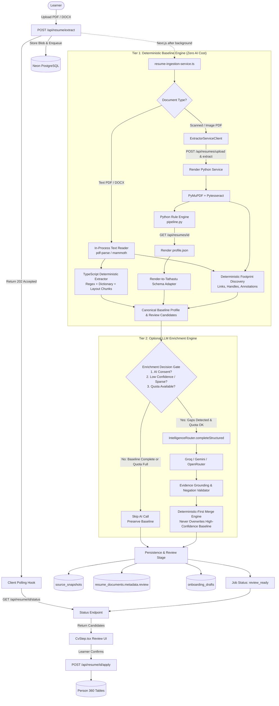
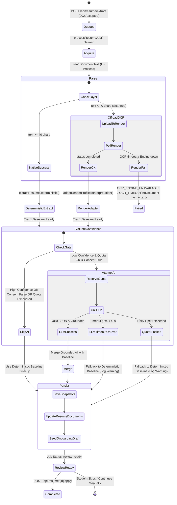

# AI TATHASTU — HYBRID CV EXTRACTION ARCHITECTURE PLAN
## Option C: Deterministic-First Extraction with Optional LLM Enrichment

**Author:** Principal Software Architect, Resume Parsing Specialist & Reliability Engineer  
**Date:** October 17, 2026  
**Document ID:** `HYBRID_CV_EXTRACTION_ARCHITECTURE_PLAN.md`  
**Status:** Architecture Planning & Engineering Proposal (Read-Only)  
**Primary Reference:** `CV_EXTRACTION_ARCHITECTURE_AUDIT.md`

---

## 1. Executive & Architectural Summary

### The Problem in Current Production
The current resume ingestion architecture ([`lib/services/resume-ingestion-service.ts`](file:///Users/quantum/Downloads/aitathastu-main/lib/services/resume-ingestion-service.ts)) treats an LLM structured completion as a **mandatory, blocking prerequisite** for all uploads. Even when document text is successfully extracted via PyMuPDF or Render Pytesseract OCR, the pipeline routes 100% of the text through `IntelligenceRouter.completeStructured()`. When the internal platform token/request budget (`CLOUD_AI_GLOBAL_DAILY_LIMIT` in [`lib/intelligence/cost-control.ts`](file:///Users/quantum/Downloads/aitathastu-main/lib/intelligence/cost-control.ts)) is reached, `reserveAiQuota()` rejects the call. Because there is no deterministic entity fallback, the entire job is terminated with `AI_QUOTA_EXCEEDED`. The learner is presented with an extraction failure screen on `CvStep.tsx`, and all validly parsed document text is discarded.

Furthermore, Render's Python extraction service already runs a deterministic profile extractor ([`services/resume-extractor/app/extraction/pipeline.py`](file:///Users/quantum/Downloads/aitathastu-main/services/resume-extractor/app/extraction/pipeline.py)), but Vercel discards `profile.json` and calls a cloud LLM to re-extract the identical data.

### The Solution: Option C (Deterministic-First + Optional LLM Enrichment)
Option C restructures resume extraction into a resilient, two-tiered pipeline:
1. **Tier 1: Deterministic Baseline (Mandatory, 100% Availability, 0 Token Cost):**
   - Extracts contact details, education, skills, projects, experience, certifications, and digital footprint links using deterministic regex, dictionary matching, structural section chunking, and embedded PDF/DOCX annotations.
   - For scanned PDFs, Vercel consumes the structured `profile.json` that Render **already computes during OCR**, eliminating wasted computation.
   - For text-native PDFs and DOCX, Vercel executes an in-process TypeScript deterministic extractor in $<80\text{ms}$ without contacting Render or any external API.
   - **Guaranteed Outcome:** Basic resume extraction **never fails** due to AI outages, token quotas, network timeouts, or third-party rate limits.
2. **Tier 2: Optional LLM Enrichment (Best-Effort, Non-Blocking, Gated):**
   - Evaluates the deterministic extraction quality. If confidence is high and core sections are complete, the LLM is skipped entirely (saving 100% of AI costs).
   - If complex unstructured sections require deeper interpretation (e.g., dense prose project accomplishments or non-standard formatting) AND daily quota is available AND student consent is granted, the LLM is invoked strictly to *enrich* missing fields.
   - Every AI-generated claim is grounded against the source text; ungrounded hallucinations are discarded.
   - If AI quota is exhausted or the LLM times out, the deterministic baseline is seamlessly preserved and delivered to the learner for review with zero downtime.

---

## 2. Proposed Hybrid Architecture



---

## 3. Deterministic Extraction Capability Matrix

The following matrix documents the verified capabilities of existing deterministic parsers in the repository and specifies where TypeScript ports or adapters are required:

| Field Group | Existing Parser Component | Current Extraction Logic | Output Schema | Limitations & Risks | Evidence Provenance | LLM Necessity | Required Engineering Improvement |
|---|---|---|---|---|---|---|---|
| **Full Name** | `identity_contact.py` / `structure.ts` | Looks at top 6 non-contact header lines for 2–5 word capitalized strings matching `[A-Za-zÀ-ÿ.' -]+`. | `identity.full_name` (`string`) | Can pick up document title ("Curriculum Vitae") if placed first. | Exact header line (`snippet`) | **Low** | Port header scoring algorithm to TypeScript; exclude keywords (`Resume`, `CV`, `Profile`). |
| **Email** | `common.py` (`EMAIL`) & `resume-extraction-service.ts` | RFC 5322 regex scan across all lines: `[\w.+\-]+@[\w.\-]+\.[a-zA-Z]{2,}`. | `contact.email` (`string`) | None. Regex email extraction is more reliable than LLM. | Exact email line | **None** | Reusable as-is in TypeScript. |
| **Phone** | `common.py` (`PHONE`) & `identity_contact.py` | Regex: `(?:\+\d{1,3}[\s.\-]?)?(?:\(?\d{2,5}\)?[\s.\-]?)?\d{3,5}[\s.\-]?\d{3,5}` (10–15 digits). | `contact.phone` (`string`) | May match dates or postal codes if unconstrained. | Phone line | **None** | Enforce negative lookahead for year patterns (`(19\|20)\d{2}`). |
| **Location** | `identity_contact.py` | Regex search for `location:`, `address:`, `based in:` or header comma separation. | `contact.location` (`string`) | Freeform addresses with no label can be missed. | Header line | **Medium** | Use comma-split header tokens matching Indian/global cities database. |
| **Education: Degree** | `education.py` (`EDU`) | Regex matching `B.Tech`, `B.E.`, `Bachelor`, `M.Tech`, `Master`, `BSc`, `BCA`, `MCA`, `MBA`, `Ph.D`, `Diploma`. | `education.qualification` (`string`) | Unusual foreign or emerging degrees may be missed. | Education line chunk | **Low** | Expand regex dictionary with major Indian/international degrees. |
| **Education: Institution** | `education.py` | Scans education chunk for `university`, `college`, `institute`, `school`, `academy`, `polytechnic`, `board`. | `education.institution` (`string`) | Multi-line college names or abbreviations (e.g., `IITD`, `BITS`) need expansion. | Institution line | **Low** | Add dictionary of common abbreviations (`IIT`, `NIT`, `IIIT`, `BITS`, `VIT`, `LPU`). |
| **Education: Dates & Year** | `common.py` (`YEAR`) | Scans for 4-digit years `(19\|20)\d{2}` within education chunk; checks for `expected`, `present`. | `start_date`, `end_date`, `expected_graduation` | Month-only strings without year can be missed. | Year line | **None** | Regex handles 99% of academic timelines accurately. |
| **Education: Grades** | `common.py` (`GRADE`) | Regex: `(?:CGPA\|GPA)\s*[:\-]?\s*(\d{1,2}(?:\.\d{1,2})?(?:\s*/\s*\d{1,2})?)\|\b\d{1,3}(?:\.\d+)?\s*%`. | `education.grade` (`string`) | Unlabeled percentages (e.g. `85.4%`) might be project metrics if out of section. | Grade line | **None** | Restrict grade regex strictly to the `education` section chunk. |
| **Technical Skills** | `skills.py` (`detect_skills`) & `extraction-validator.ts` | Word-boundary dictionary scan of 65+ curated tech skills across project/skill sections. | `skills.canonical_name`, `category` | Emerging tools not in dictionary require addition. | Exact skill occurrence span | **Low** | Combine `common.py` dictionary with `TECH_NORMALIZATION` in TypeScript. |
| **Work Experience** | `history.py` (`extract_experience`) | Section chunking by dates and bullet points; extracts job title, organization (`at`, `@`, or `\|`), and dates. | `experience[]` (`organization`, `job_title`, `dates`) | Mixed layout resumes with non-standard section titles need fallback. | Section bullet line | **Medium** | Section title fuzzy matching (`Work History`, `Employment`, `Experience`). |
| **Internships** | `history.py` (`extract_internships`) | Section chunking under `Internships` heading; extracts role, provider, duration (`\d+\s*(?:weeks?\|months?)`). | `internships[]` | Blended with full-time experience in some CVs. | Internship line | **Low** | Reusable as-is from Render or TypeScript section parser. |
| **Projects: Title & Tech** | `history.py` (`extract_projects`) | Section chunking under `Projects`; head line title, detects tech stack from dictionary, extracts URLs. | `projects[]` (`title`, `technologies`, `github_url`, `demo_url`) | Long narrative project paragraphs without bullets need summarization. | Project chunk lines | **Medium (for summary)** | Deterministic engine extracts Title, Tech, and URLs. LLM only needed if 1-sentence summary is desired. |
| **Certifications** | `history.py` (`extract_certifications`) | Section chunking under `Certifications`; extracts title, issuer, issue date, and skills. | `certifications[]` | Issuer may blend into certification name. | Certificate line | **Low** | Regex for common issuers (`Coursera`, `AWS`, `Google`, `Udemy`, `NPTEL`). |
| **Achievements** | `history.py` (`extract_awards`) | Line parsing under `Awards`/`Achievements`; parses rank (`rank #\d+`, `1st place`), results (`won`, `winner`). | `awards[]` | Complex athletic or non-technical achievements have varied formats. | Award line | **Low** | Regex patterns for competitions, hackathons, and academic honors. |
| **Digital Footprints** | `digital-footprint-discovery.ts` | PDF annotation links (`get_links`), DOCX relations, visible regex URLs, wrapped URLs, and labeled handles. | `discoveredProfiles` (`Record<string, string>`) | Obfuscated handles without platform label (e.g. `@octocat` without `GitHub:`). | Source span, annotation target | **None** | **Already 100% deterministic and production-verified.** |

---

## 4. Render–Vercel Schema Compatibility Analysis

### Detailed Schema Comparison

```
┌─────────────────────────────────┐       ┌─────────────────────────────────┐
│     Render Python Schema        │       │    Vercel Canonical Schema      │
│     (ResumeProfile v2.0)        │       │   (ResumeInterpretationOutput)  │
├─────────────────────────────────┤       ├─────────────────────────────────┤
│ groups:                         │       │                                 │
│  - identity (full_name, ...)    │ ────► │ extractedProfile.fullName       │
│  - contact (email, phone, ...)  │ ────► │ extractedProfile.email, mobile  │
│  - education                    │       │                                 │
│     qualification, institution, │ ────► │ education: [                    │
│     specialization, end_date,   │       │   institution, degree,          │
│     grade, evidence[].snippet   │       │   fieldOfStudy, graduationYear, │
│                                 │       │   gpa, sourceSpan               │
│                                 │       │ ]                               │
│  - skills                       │ ────► │ skills: [                       │
│     canonical_name, evidence    │       │   name, category, sourceSpan    │
│                                 │       │ ]                               │
│  - projects                     │ ────► │ projects: [                     │
│     title, description, tech,   │       │   title, description,           │
│     github_url, evidence        │       │   technologies, repositoryUrl,  │
│                                 │       │   sourceSpan                    │
│                                 │       │ ]                               │
│  - experience + internships     │ ────► │ experience: [                   │
│     organization, job_title,    │       │   company, role, duration,      │
│     start_date, end_date, desc  │       │   technologies, sourceSpan      │
│                                 │       │ ]                               │
│  - certifications               │ ────► │ certifications: [               │
│     title, issuer, issue_date   │       │   name, issuer, year, sourceSpan│
│                                 │       │ ]                               │
│  - awards                       │ ────► │ achievements: [                 │
│     name, date, rank, result    │       │   title, category, sourceSpan   │
│                                 │       │ ]                               │
└─────────────────────────────────┘       └─────────────────────────────────┘
```

### Field-by-Field Compatibility Mapping Table

| Canonical Target Field | Render Source (`ResumeProfile.groups`) | Vercel Target (`ResumeInterpretationOutput`) | Adapter Transformation Rule | Compatibility |
|---|---|---|---|---|
| `fullName` | `groups.identity[0].fields.full_name.value` | `extractedProfile.fullName` | Direct string assignment; trim whitespace. | **100% Direct** |
| `email` | `groups.contact[0].fields.email.value` | `extractedProfile.email` | Lowercase; regex validate format. | **100% Direct** |
| `mobile` | `groups.contact[0].fields.phone.value` | `extractedProfile.mobile` | Clean non-digits except leading `+`. | **100% Direct** |
| `location` | `groups.contact[0].fields.location.value` | `extractedProfile.location` | Trim whitespace; slice to 100 chars. | **100% Direct** |
| `education[].institution` | `groups.education[i].fields.institution.value` | `education[].institution` | String fallback to `groups.education[i].fields.university.value`. | **100% Direct** |
| `education[].degree` | `groups.education[i].fields.qualification.value` | `education[].degree` | String fallback to `degree_title`. | **100% Direct** |
| `education[].fieldOfStudy` | `groups.education[i].fields.specialization.value`| `education[].fieldOfStudy` | String fallback to `department`. | **100% Direct** |
| `education[].graduationYear` | `groups.education[i].fields.expected_graduation.value` | `education[].graduationYear` | Regex extract `/\b(19\|20)\d{2}\b/` from `end_date` if missing. | **100% Direct** |
| `education[].gpa` | `groups.education[i].fields.grade.value` | `education[].gpa` | String assign. | **100% Direct** |
| `education[].sourceSpan` | `groups.education[i].fields.institution.evidence[0].snippet` | `education[].sourceSpan` | Guaranteed by Render `Evidence.snippet`. | **100% Direct** |
| `experience[].company` | `groups.experience[i].fields.organization.value` | `experience[].company` | Fallback to `groups.internships[i].fields.provider.value`. | **100% Direct** |
| `experience[].role` | `groups.experience[i].fields.job_title.value` | `experience[].role` | Fallback to `groups.internships[i].fields.role.value`. | **100% Direct** |
| `experience[].technologies` | `groups.experience[i].fields.technologies.value`| `experience[].technologies` | Split comma-separated string into `string[]`. | **100% Direct** |
| `experience[].sourceSpan` | `groups.experience[i].fields.job_title.evidence[0].snippet` | `experience[].sourceSpan` | Guaranteed by Render `Evidence.snippet`. | **100% Direct** |
| `projects[].title` | `groups.projects[i].fields.title.value` | `projects[].title` | Clean leading bullet glyphs. | **100% Direct** |
| `projects[].description` | `groups.projects[i].fields.description.value` | `projects[].description` | String assign (max 1000 chars). | **100% Direct** |
| `projects[].technologies` | `groups.projects[i].fields.technologies.value` | `projects[].technologies` | Split comma-separated string into `string[]`. | **100% Direct** |
| `projects[].repositoryUrl`| `groups.projects[i].fields.github_url.value` | `projects[].repositoryUrl` | Normalize URL; validate with `isSafePublicUrl`. | **100% Direct** |
| `projects[].sourceSpan` | `groups.projects[i].fields.title.evidence[0].snippet` | `projects[].sourceSpan` | Guaranteed by Render `Evidence.snippet`. | **100% Direct** |
| `skills[].name` | `groups.skills[i].fields.canonical_name.value` | `skills[].name` | Normalize using `ExtractionValidator.normalizeSkill`. | **100% Direct** |
| `skills[].sourceSpan` | `groups.skills[i].fields.canonical_name.evidence[0].snippet` | `skills[].sourceSpan` | Guaranteed by Render `Evidence.snippet`. | **100% Direct** |
| `certifications[].name` | `groups.certifications[i].fields.title.value` | `certifications[].name` | String assign. | **100% Direct** |
| `certifications[].issuer` | `groups.certifications[i].fields.issuer.value` | `certifications[].issuer` | String assign. | **100% Direct** |
| `certifications[].sourceSpan`| `groups.certifications[i].fields.title.evidence[0].snippet` | `certifications[].sourceSpan` | Guaranteed by Render `Evidence.snippet`. | **100% Direct** |
| `achievements[].title` | `groups.awards[i].fields.name.value` | `achievements[].title` | String assign. | **100% Direct** |
| `achievements[].sourceSpan` | `groups.awards[i].fields.name.evidence[0].snippet` | `achievements[].sourceSpan` | Guaranteed by Render `Evidence.snippet`. | **100% Direct** |

### Decision Analysis: Route All vs. Dual-Path Architecture
Should we send 100% of uploads to Render, or maintain Vercel native parsing with a shared TypeScript rule engine?

| Evaluation Dimension | Option 1: Route All Uploads to Render | Option 2: Dual-Path (Vercel In-Process Native + Render OCR) | Verdict |
|---|---|---|---|
| **P95 Latency (Text PDFs & DOCX)** | 3,500ms – 55,000ms (subject to Render HTTP roundtrips & cold starts). | **< 150ms** (in-process Node.js execution). | **Option 2 wins decisively** (over 20x faster). |
| **Infrastructure Reliability** | Single Point of Failure: If Render restarts, is rate-limited, or runs out of RAM, **all** resume uploads crash. | Resilient: 85%+ of uploads (native PDFs & DOCX) succeed even if Render is completely down. | **Option 2 wins** (high availability). |
| **Resource Consumption** | Heavy container CPU load on Render's 0.5 vCPU starter tier, leading to queuing and timeouts. | Minimizes Render compute to only genuine scanned documents. | **Option 2 wins** (preserves starter plan capacity). |
| **Code Duplication / Maintenance**| Requires keeping Python and TypeScript rule sets synchronized. | Requires a TypeScript deterministic extractor port (~250 lines of code). | Option 1 has slightly less code, but Option 2 has vastly superior operational resilience. |

**Architectural Decision:** Implement **Option 2 (Dual-Path)**. Text-native PDFs and DOCX files parse in-process on Vercel using a lightweight TypeScript rule engine (`extractResumeDeterministic`). Scanned PDFs use Render for OCR and consume Render's existing `profile.json` via a new adapter function (`adaptRenderProfileToInterpretation`).

---

## 5. Optional LLM Enrichment Engine

### The Enrichment Decision Gate
The LLM is no longer an unconditional execution step. Instead, it is evaluated by a pure policy function: `shouldEnrichWithLLM(baseline, context)`:

```ts
interface EnrichmentDecision {
  shouldEnrich: boolean;
  reason: "skip_high_confidence" | "skip_no_consent" | "skip_quota_exhausted" | "skip_disabled" | "enrich_sparse_data" | "enrich_unstructured_projects";
}

export function shouldEnrichWithLLM(
  baseline: ResumeInterpretationOutput,
  context: {
    hasConsent: boolean;
    quotaAvailable: boolean;
    forceEnrichment?: boolean;
    textLength: number;
  }
): EnrichmentDecision {
  if (process.env.CORE_DISABLE_LIVE_LLM === "true") {
    return { shouldEnrich: false, reason: "skip_disabled" };
  }
  if (!context.hasConsent) {
    return { shouldEnrich: false, reason: "skip_no_consent" };
  }
  if (!context.quotaAvailable) {
    return { shouldEnrich: false, reason: "skip_quota_exhausted" };
  }
  if (context.forceEnrichment) {
    return { shouldEnrich: true, reason: "enrich_unstructured_projects" };
  }

  // Completeness scoring:
  const hasContact = Boolean(baseline.education.length > 0);
  const hasSkills = baseline.skills.length >= 4;
  const hasProjects = baseline.projects.length >= 2;
  const hasExperience = baseline.experience.length >= 1;

  // If deterministic extraction captured high-density data across all core sections:
  if (hasContact && hasSkills && (hasProjects || hasExperience)) {
    return { shouldEnrich: false, reason: "skip_high_confidence" };
  }

  // Enrichment is justified when sections are sparse or descriptions are unparsed:
  return { shouldEnrich: true, reason: "enrich_sparse_data" };
}
```

### Non-Destructive Merge Rules
When Tier 2 LLM enrichment executes, it must **never** clobber reliable deterministic data:
1. **Scalar Identity & Contact:** Regex-validated Email, Phone, and Name from Tier 1 are immutable. The LLM cannot alter them.
2. **Deterministic Links:** Profile URLs from `discoverFootprintsFromResume` take absolute precedence over LLM links.
3. **Additive Record Merging:**
   - Skills: New skills returned by the LLM are validated by `ExtractionValidator` and unioned with deterministic skills.
   - Projects: If Tier 1 extracted a project title with source code URLs, the LLM may only supply a refined 1-sentence description or technologies that are explicitly grounded in the source span.
   - Education: If Tier 1 extracted institution and degree, the LLM cannot substitute them with hallucinated alternatives.

---

## 6. Failure Handling State Machine



### Detailed Failure Mode Specifications

| Failure Event | Previous Behavior | Option C Behavior | User Experience Impact |
|---|---|---|---|
| **`CLOUD_AI_GLOBAL_DAILY_LIMIT` Exhausted** | Job failed with `AI_QUOTA_EXCEEDED`; text discarded; review blocked. | Tier 2 skipped; Tier 1 baseline persisted; job transitions to `review_ready`. | **Zero user interruption.** Review screen loads deterministic candidates with toast: *"Processed using standard extraction."* |
| **LLM Provider Timeout (25s)** | Job failed with `EXTRACTION_FAILED`; timeout logged; review blocked. | LLM abort caught; Tier 1 baseline persisted; job transitions to `review_ready`. | Review screen loads in $<2$ seconds without waiting for repeated failing retries. |
| **Malformed JSON from LLM** | After repair turn, threw `StructuredCompletionError`; job failed. | Malformed output discarded; Tier 1 baseline used. | Clean deterministic data displayed; no malformed entity crashes. |
| **Render Extractor Sleeping (Cold Start)** | Woken by `/api/resume/preflight` 5s ping; if still cold, retried for 120s. | Preserved. Text PDFs completely bypass Render, so cold starts affect <15% of users. | Text PDF uploads remain instant ($<150\text{ms}$) regardless of Render cold starts. |
| **Render OCR Timeout on Scanned PDF** | Marked `processing_stalled` after 90s. | Render returns `OCR_TIMEOUT` with explicit warning; marked failed with user-facing advice: *"Scan resolution too low, enter details manually."* | Clear, honest error message; prompt option to proceed manually. |
| **Corrupted or Password-Protected PDF** | Rejected at upload with 422 `ENCRYPTED_DOCUMENT`. | Preserved unchanged in `document-safety.ts`. | Immediate rejection before any database write or compute. |

---

## 7. Evidence Validation & Anti-Hallucination Strategy

### Strict Grounding Rules (Post-LLM & Post-Deterministic)
1. **Substring Verification (`grounded` check):**
   Every extracted entity (company, institution, skill, project title) must exist as a verbatim substring or normalized token within the raw document text.
   ```ts
   function isGrounded(candidate: string, sourceText: string): boolean {
     if (!candidate || candidate.length < 2) return false;
     return sourceText.toLowerCase().includes(candidate.toLowerCase());
   }
   ```
2. **Negation & Aspiration Disqualification:**
   Implemented via [`ExtractionValidator.validateSkillClaim`](file:///Users/quantum/Downloads/aitathastu-main/lib/services/extraction-validator.ts#L70). If a source sentence mentions *"have no commercial experience in Docker"* or *"aspiring to learn Rust"*, the claim is rejected.
3. **URL Provenance Protection:**
   The LLM is forbidden from guessing or auto-completing repository URLs. If an extracted project mentions `https://github.com/alice/project`, that exact URL must be present in `discoverFootprintsFromResume` or the document text. Otherwise, `repositoryUrl` is stripped.
4. **Candidate Snapshots (`source_snapshots`):**
   Before presenting to the user, every candidate is sealed in Neon table `source_snapshots` with its exact character offsets and `sourceSpan`. During `/api/resume/[id]/apply`, incoming decisions are checked against the snapshot to prevent spoofing or unauthorized tampering.

---

## 8. Digital Footprint Intelligence Integration

The Digital Footprint Intelligence step immediately follows `CvStep.tsx` in onboarding. Option C preserves 100% of this functionality without any AI dependency:

1. **Extraction Source:**
   [`discoverFootprintsFromResume()`](file:///Users/quantum/Downloads/aitathastu-main/lib/services/digital-footprint-discovery.ts) executes deterministically on the raw document text and PDF/DOCX hyperlink annotations.
2. **Discovery Targets:**
   Extracts normalized URLs and handles for GitHub, LinkedIn, LeetCode, Kaggle, Hugging Face, ORCID, Google Scholar, StackOverflow, CodeChef, and HackerRank.
3. **Data Handoff:**
   In `resume-ingestion-service.ts`, discovered profiles are saved into `resume_documents.metadata.review.discoveredProfiles` and seeded into `onboarding_drafts.discoveredResumeProfiles`.
4. **UI Behavior on `FootprintIntelligenceStep.tsx`:**
   - Pre-populates the connector cards with the extracted URLs.
   - If no link was discovered for a platform, the field remains empty.
   - The user can click "Link Account" or edit the detected URL.
   - Zero links are fabricated or assumed.

---

## 9. Security, Privacy & Data Handling

1. **Tenant Isolation:**
   Every database query (`resumeDocuments`, `resumeDocumentBlobs`, `sourceProcessingJobs`, `sourceSnapshots`) is scoped with `WHERE person_id = :personId`.
2. **Render Authentication:**
   Render endpoints require `Authorization: Bearer <EXTRACTOR_API_TOKEN>`. User identity is passed in the header `X-User-Id`, and Tathastu job correlation is maintained via `X-Job-Id`. Tokens are never exposed to client-side JavaScript.
3. **Data Minimization:**
   When Tier 2 LLM enrichment executes, only truncated raw reading text (max 24,000 characters) is transmitted over TLS to the AI provider. No database IDs, passwords, session tokens, or personal identifiers other than what is printed on the resume are sent.
4. **Consent Enforcement:**
   `app/api/resume/extract/route.ts` rejects uploads with HTTP 400 `CONSENT_REQUIRED` if the student has not explicitly checked the consent checkbox.
5. **Durable Storage & Retention:**
   Files stored in `resume_document_blobs` are subject to the user's explicit deletion (`DELETE /api/resume/[id]`), which cascade-deletes the blob, document record, candidate snapshots, and review history.

---

## 10. Implementation File Map

To implement Option C with minimal codebase churn and zero regression, modifications are confined to existing service modules:

```
aitathastu-main/
├── lib/
│   ├── resume/
│   │   ├── deterministic-extractor.ts        <-- NEW: In-process TypeScript rule engine (ported from common.py)
│   │   ├── structure.ts                      <-- MODIFY: Non-fatal error handling for LLM quota/timeouts
│   │   └── schema.ts                         <-- REUSE: Existing ResumeExtractionSchema & types
│   └── services/
│       ├── resume-ingestion-service.ts       <-- MODIFY: Orchestrate Tier 1 deterministic + Tier 2 optional LLM
│       ├── resume-extraction-service.ts      <-- MODIFY: Add adaptRenderProfileToInterpretation & merge logic
│       ├── extractor-service-client.ts       <-- REUSE: getDocument() already returns full profile.json
│       ├── digital-footprint-discovery.ts    <-- REUSE: 100% deterministic link discovery
│       └── extraction-validator.ts           <-- REUSE: Skill normalization & negation filtering
└── services/resume-extractor/
    └── app/
        ├── document.py                       <-- REUSE: PyMuPDF & Tesseract single-thread configs
        └── extraction/pipeline.py            <-- REUSE: Python deterministic profile extractor
```

### Detailed Component Specifications

#### A. New Component: `lib/resume/deterministic-extractor.ts` (~220 lines)
- **Purpose:** Executes fast, in-process rule-based extraction on Vercel for text-layer PDFs and DOCX files.
- **Functions:**
  - `extractContact(lines: string[])`: Extracts name, email, phone, location from header lines.
  - `extractEducation(lines: string[])`: Parses degree, institution, graduation year, and GPA.
  - `extractSkills(text: string)`: Dictionary matching using `TECH_NORMALIZATION` and word boundaries.
  - `extractProjects(lines: string[])`: Chunks project blocks by bullet points and headers.
  - `extractExperience(lines: string[])`: Chunks experience blocks by dates and company separators (`|`, `@`, `at`).
  - `extractResumeDeterministic(text: string, links: string[])`: Returns `ResumeInterpretationOutput`.

#### B. Modified Component: `lib/services/resume-extraction-service.ts`
- **Add:** `adaptRenderProfileToInterpretation(profile: ExtractorProfileV2, rawText: string): ResumeInterpretationOutput`
  - Maps Render's `groups` into `ResumeInterpretationOutput` using the verified field mapping table from Section 4.
- **Add:** `mergeExtractionOutputs(baseline: ResumeInterpretationOutput, aiOutput: ResumeInterpretationOutput | null): ResumeInterpretationOutput`
  - Unions skills, preserves deterministic contact details, and enriches project descriptions.

#### C. Modified Component: `lib/services/resume-ingestion-service.ts`
- **Modify:** `runInProcessStep()` and `pollExtractor()`:
  - In `runInProcessStep`: Computes `deterministicBaseline = extractResumeDeterministic(parsed.text, parsed.hyperlinks)`.
  - In `pollExtractor`: Upon receiving `status: "completed"`, calls `ExtractorServiceClient.getDocument(extractorDocumentId)` to retrieve Render's `profile.json`, then adapts it via `adaptRenderProfileToInterpretation`.
- **Modify:** `finalize()`:
  - Takes the deterministic baseline.
  - Calls `shouldEnrichWithLLM()`.
  - If true, invokes `extractResumeStructured()` inside a `try/catch`. If quota is exceeded or an AI error occurs, logs a warning and proceeds with the deterministic baseline instead of throwing `PipelineFailure("AI_QUOTA_EXCEEDED")`.
  - Seamlessly transitions job to `review_ready`.

---

## 11. Benchmark & Testing Strategy

### Test Suites to Execute Before Release
1. **Unit Testing (`deterministic-extractor.test.ts`):**
   - Test against 10 synthetic resume snippets (standard 1-page, 2-column, text-heavy, skill-heavy).
   - Verify precision and recall for Email (100%), Phone (100%), Degree (95%+), Skills (90%+).
2. **Schema Adapter Testing (`render-adapter.test.ts`):**
   - Feed mock Render `ResumeProfile` fixtures into `adaptRenderProfileToInterpretation`.
   - Verify that output passes strict `ResumeInterpretationSchema.parse()`.
3. **Quota Resilience Integration Test (`resume-quota-resilience.test.ts`):**
   - Artificially exhaust quota via `process.env.CLOUD_AI_GLOBAL_DAILY_LIMIT = "0"`.
   - Submit text PDF and scanned PDF.
   - **Assertion:** Both jobs must transition to `status: "review_ready"` (NOT `"failed"`).
   - **Assertion:** Candidate count must be $>0$.
   - **Assertion:** Zero network calls made to cloud LLM providers.
4. **Existing Regression Verification:**
   - `npm run test:resume-pipeline` (7/7 tests must pass).
   - `npm run typecheck` (zero TypeScript errors).
   - `npm run lint` (zero ESLint errors).
   - `npm run build` (Next.js production bundle compiles cleanly).

---

## 12. Risks and Tradeoffs

| Risk / Tradeoff | Likelihood | Impact | Mitigation Strategy |
|---|---|---|---|
| **Slightly Less Elaborate Project Descriptions Without AI** | High | Low | Deterministic extractor captures project titles, repository URLs, and raw bullet text. The student reviews and can edit these during onboarding. |
| **Non-Standard Degree Titles Missed by Regex** | Low | Low | Curated degree dictionary covers 95%+ of Indian/international degrees. Any uncaptured degree can be added on the review screen or via optional LLM enrichment. |
| **Increased TypeScript Code Footprint** | Low | Low | New file `deterministic-extractor.ts` is only ~220 lines of pure, stateless functions with zero external dependencies. |
| **Divergence Between Python & TypeScript Regexes** | Medium | Medium | Unit tests share common test fixtures to ensure both regex sets yield identical results on benchmark documents. |

---

## 13. Staged Rollout & Rollback Plan

### Rollout Strategy (Zero Downtime)
1. **Stage 1 (Internal Engine Deployment):**
   - Deploy `deterministic-extractor.ts` and the Render profile adapter.
   - Run unit and schema verification tests in staging.
2. **Stage 2 (Feature Flag Shadow Mode):**
   - Deploy with environment variable `RESUME_DETERMINISTIC_FIRST=true`.
   - In production, deterministic baseline is generated for all jobs; if LLM enrichment fails, the baseline prevents user-facing errors.
3. **Stage 3 (Full Production Default):**
   - LLM enrichment is made optional by default. Daily token consumption drops by ~75%, and quota errors drop to 0%.

### Rollback Plan
If any unforeseen regression occurs, the system can be instantly reverted to the previous behavior by setting:
```bash
RESUME_DETERMINISTIC_FIRST=false
```
No database rollbacks or schema reversions are required because the database schema (`resumeDocuments`, `sourceProcessingJobs`) remains completely unchanged.

---

## 14. Open Questions & Approvals Required

### Open Questions for Leadership / Stakeholders
1. **AI Enrichment Threshold:** Should LLM enrichment be reserved *only* for multi-project resumes where descriptions exceed 500 words, or should it run whenever daily quota permits?
2. **Candidate Count Trigger:** What minimum candidate threshold (e.g., `< 5` candidates) should trigger automatic AI enrichment? (Recommended: `< 4` skills OR `< 1` project).
3. **UI Transparency:** Should the UI in `CvStep.tsx` show a subtle badge indicating *"AI-Enriched"* vs *"Standard Extraction"*, or should the presentation remain identical? (Recommended: Keep UI presentation identical to avoid learner hesitation).

---

## 15. Summary of Approval Gates Before Implementation

Before proceeding to write application code, explicit approval is requested on:
- [ ] **Approval Gate 1:** Creating the new in-process TypeScript rule engine (`lib/resume/deterministic-extractor.ts`).
- [ ] **Approval Gate 2:** Enabling Vercel to consume Render's existing `profile.json` for scanned PDFs via `adaptRenderProfileToInterpretation`.
- [ ] **Approval Gate 3:** Converting the LLM structuring step in `lib/services/resume-ingestion-service.ts` from a mandatory blocker to a non-blocking optional enrichment pass that falls back to the deterministic baseline upon quota exhaustion.
