# AI Tathastu — Phase 0 Component & Functional Architecture Audit

> **Document ID:** `AUDIT-ARCH-004`  
> **Status:** READ-ONLY ARCHITECTURAL MAPPING (PHASE 0)  
> **Repository:** `anant9934/aitathastu`  
> **Target Scope:** Component Hierarchy, Shared UI Tokens, State Management, API Boundaries, and Invariant Functional Contracts  

---

## 1. Onboarding Component Dependency Map

```mermaid
graph TD
    Page["app/onboarding/page.tsx<br/>(Server Component)"] --> App["components/onboarding/OnboardingApp.tsx<br/>(Client Controller)"]
    App --> Flow["lib/client/onboarding/use-onboarding-flow.ts<br/>(State Hook)"]
    App --> Shell["components/onboarding/OnboardingShell.tsx<br/>(Shell, Stepper, Header, Footer)"]
    App --> EoraGuide["components/onboarding/EoraGuideLine.tsx<br/>(Inline AI Guidance)"]
    
    Shell --> Stepper["12-Step Progress Pip Stepper"]
    Shell --> StepHeader["StepHeader (Title, Desc, EORA)"]
    Shell --> StepFooter["StepFooter (Back, Next, Saving, Skip)"]

    App --> StepWelcome["WelcomeStep (Screen 2)"]
    App --> StepRole["RoleStep (Screen 3)"]
    App --> StepDirection["DirectionStep (Screen 3.2)"]
    App --> StepPriorities["PrioritiesStep (Screen 3.5)"]
    App --> StepCv["CvStep (Screen 5)"]
    App --> StepFootprint["FootprintIntelligenceStep (Screen 5.5)"]
    App --> StepDetails["DetailsStep (Screen 4)"]
    App --> StepAccounts["AccountsStep (Screen 6)"]
    App --> StepImport["ImportStep (Screen 7)"]
    App --> StepReview["ReviewStep (Screen 8)"]
    App --> StepSkills["SkillsStep (Screen 9)"]
    App --> StepProjects["ProjectsStep (Screen 10)"]
    App --> StepFinish["FinishStep (Screen 11)"]
    App --> StepFaculty["FacultyStep (Screen 3.7)"]

    StepCv --> ResumeUpload["lib/client/resume/upload.ts"]
    StepFootprint --> DfiHook["lib/client/use-digital-footprint.ts"]
    StepImport --> SourceProgress["components/connections/SourceProgress.tsx"]
    StepReview --> EntryList["components/review/EntryList.tsx"]
    StepReview --> SourceFilter["components/review/SourceFilter.tsx"]
    StepSkills --> SkillsMap["components/skills/SkillsMap.tsx"]
    StepSkills --> EvidenceStrip["components/ui/EvidenceStrip.tsx"]
```



---

## 2. Component Inventory & Responsibilities

| Component File Path | Component Name | Responsibility | Reusability | Responsive Behavior | Modification Risk for UI Upgrade |
|:---|:---|:---|:---:|:---:|:---:|
| `components/onboarding/OnboardingApp.tsx` | `OnboardingApp` | Main step router, draft binding, optimistic commits | High (Onboarding only) | Wraps child steps with `shell(children, width)` | **Medium:** Route numbering must not change |
| `components/onboarding/OnboardingShell.tsx` | `OnboardingShell`, `StepHeader`, `StepFooter` | Master layout container, header stepper, action footer | Onboarding only | Hardcoded max-width: 760px vs 1120px | **High:** Root cause of desktop narrowness; safe to modify width tokens |
| `components/onboarding/EoraGuideLine.tsx` | `EoraGuideLine` | Renders contextual AI guidance with typing simulation | Onboarding only | Inline vertical block below header | **Low/Safe:** Can be relocated into sidebar without breaking logic |
| `components/onboarding/steps/WelcomeStep.tsx` | `WelcomeStep` | First screen, identity name input, hero | Onboarding only | Single-column centered box | **Low/Safe:** Purely visual/input presentation |
| `components/onboarding/steps/RoleStep.tsx` | `RoleStep` | Student vs Faculty choice | Onboarding only | 2-card vertical stack | **Low/Safe:** Card presentation only |
| `components/onboarding/steps/DirectionStep.tsx` | `DirectionStep` | 12 AI/ML target role selection | Onboarding only | `grid-cols-1 sm:grid-cols-2` | **Low/Safe:** Can become 3–4 columns on desktop |
| `components/onboarding/steps/PrioritiesStep.tsx` | `PrioritiesStep` | Learning priorities ranking | Onboarding only | Vertical list stack | **Low/Safe:** Reordering UI presentation |
| `components/onboarding/steps/CvStep.tsx` | `CvStep` | Resume PDF upload & consent | Onboarding only | Centered dropzone box | **Medium:** File upload transport must not break |
| `components/onboarding/steps/FootprintIntelligenceStep.tsx` | `FootprintIntelligenceStep` | 13-platform connected grid | Onboarding only | `grid-cols-1 sm:grid-cols-2` | **Low/Safe:** Grid layout can expand safely; API bindings intact |
| `components/onboarding/steps/DetailsStep.tsx` | `DetailsStep` | Academic fields & registration | Onboarding only | `sm:grid-cols-2` | **Medium:** Form field names must match draft schema |
| `components/onboarding/steps/AccountsStep.tsx` | `AccountsStep` | Fallback profile URLs | Onboarding only | Vertical input stack | **Low/Safe:** Secondary fallback screen |
| `components/onboarding/steps/ImportStep.tsx` | `ImportStep` | Live source import progress | Onboarding only | Card container | **Medium:** Auto-advance logic must remain intact |
| `components/onboarding/steps/ReviewStep.tsx` | `ReviewStep` | Multi-source profile confirmation | Onboarding only | Two-column sticky sidebar on desktop | **Medium:** Entity editing contracts must be preserved |
| `components/onboarding/steps/SkillsStep.tsx` | `SkillsStep` | Role prerequisites vs skills | Onboarding only | Single card stack | **Low/Safe:** Presentation of evidence chips |
| `components/onboarding/steps/ProjectsStep.tsx` | `ProjectsStep` | Project confirmation & add | Onboarding only | Accordion list + form | **Medium:** Project data structure must match |
| `components/onboarding/steps/FinishStep.tsx` | `FinishStep` | Final summary stat cards | Onboarding only | `grid-cols-2 sm:grid-cols-3` | **Low/Safe:** Summary metrics presentation |
| `components/onboarding/steps/FacultyStep.tsx` | `FacultyStep` | Faculty credentials registration | Onboarding only | `sm:grid-cols-2` | **Medium:** Faculty registration API contract |

---

## 3. Shared UI Library & Design Tokens

The application utilizes a tailored design system in `components/ui/*`:
- `Button.tsx`: Supports variants (`primary`, `secondary`, `danger`, `ghost`, `link`), loading spinner, icon slot.
- `Field.tsx`: `TextField`, `TextAreaField`, `Checkbox`, `SelectField` with accessible label bindings and error states.
- `Banner.tsx`: Contextual notification banner (`info`, `warning`, `danger`, `success`).
- `StatusChip.tsx`: Evidence tones (`verified`, `corroborated`, `evidenced`, `gap`, `danger`, `warning`, `busy`).
- `EvidenceStrip.tsx`: Horizontal multi-segment evidence visualizer.
- `Tabs.tsx`: Accessible tablist navigation with keyboard arrow key navigation.
- `Skeleton.tsx` & `LoadingRegion.tsx`: Shimmer loading states.
- `EmptyState.tsx`: Structured empty states with icon, title, description, and action button.

---

## 4. State Management & Data Flow Architecture

### 4.1 The Draft Protocol (`/api/onboarding-v2`)
State management is orchestrated by [lib/client/onboarding/use-onboarding-flow.ts](file:///Users/quantum/Downloads/aitathastu-main/lib/client/onboarding/use-onboarding-flow.ts):
1. **Initial Load:** Fetches `GET /api/onboarding-v2`. If unauthenticated or no server draft exists, initializes from `localStorage` (`aitathastu.onboarding.draft.v2`).
2. **Schema Versioning:** Strict `version: 2` envelope.
3. **Optimistic Updates:** `flow.setData((prev) => ({ ...prev, ...patch }))` immediately updates React state.
4. **Debounced Autosave:** `flow.autosaveSoon(patch)` debounces text field typing (1,000ms).
5. **Committed Transitions:** `flow.commit(patch, nextScreen)` synchronously writes to `PUT /api/onboarding-v2` and transitions the step index.
6. **Navigation Routing:** `flow.goBack(targetScreen)` cleanly rolls back screen indices.

### 4.2 Invariant Backend API Contracts
A future UI redesign MUST NOT modify or disrupt the following API endpoints:
- `GET /api/onboarding-v2`: Fetches current onboarding draft.
- `PUT /api/onboarding-v2`: Updates draft fields and `currentScreen`.
- `POST /api/student/resume/upload`: Transports multipart PDF for parsing.
- `GET /api/student/resume/status`: Polls parsing queue state.
- `GET /api/student/sync-status`: Real-time source synchronization status.
- `POST /api/student/connections/:platform`: OAuth and username verification endpoints.
- `POST /api/onboarding-v2/finish`: Final atomic workspace generation commit.

---

## 5. EORA AI Assistant Architecture & Redesign Feasibility

### Current Architecture
- **In Onboarding:** [components/onboarding/EoraGuideLine.tsx](file:///Users/quantum/Downloads/aitathastu-main/components/onboarding/EoraGuideLine.tsx) is rendered as a child of `StepHeader`. It receives `guide: React.ReactNode` passed down from `OnboardingApp.tsx`.
- **Outside Onboarding:** [components/eora/EoraCompanion.tsx](file:///Users/quantum/Downloads/aitathastu-main/components/eora/EoraCompanion.tsx) runs as a floating global chat drawer, but explicitly suppresses itself during onboarding:
  ```tsx
  if (pathname.startsWith("/onboarding")) return null;
  ```

### Future Presentation Feasibility Analysis
Can EORA support a modern desktop sidebar docking model?
- **Technical Verdict: YES, 100% FEASIBLE.**
- **Rationale:** `EoraGuideLine` is purely a presentational consumer of `guide` content and event listeners (`useEoraStepEvents`). It does not own data mutations.
- **Feasible Layout Models:**
  1. **Wide Desktop Sidebar ($\ge 1280\text{px}$):** Move EORA from `StepHeader` into a sticky right-hand companion column (`w-80` or `w-96`) inside `OnboardingShell`. The main interactive content area expands to `max-w-4xl` / `max-w-5xl`.
  2. **Tablet Collapsible Assistant Drawer ($768\text{px} - 1024\text{px}$):** Expandable top banner or floating pill.
  3. **Mobile Inline Assistant ($< 768\text{px}$):** Maintain the compact inline guideline directly under `StepHeader`.
