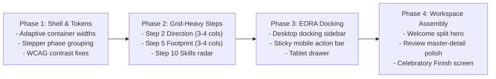

# AI Tathastu — Phase 0 Redesign Readiness & Feasibility Matrix

> **Document ID:** `AUDIT-READINESS-007`  
> **Status:** READ-ONLY REDESIGN ROADMAP SPECIFICATION (PHASE 0)  
> **Repository:** `anant9934/aitathastu`  
> **Target Audience:** Design Systems Lead, Lead Next.js Architect, Product Engineering Stakeholders  

---

## 1. Step-by-Step Redesign Feasibility Matrix

The following matrix assesses every screen for future UI/UX transformation, detailing layout patterns, responsive complexity, and regression risks:

| Step Name | Screen ID | Current Layout | Primary UI Defect | Recommended Future Layout | Responsive Complexity | Functional Risk | Safe Redesign Boundary |
|:---|:---:|:---|:---|:---|:---:|:---:|:---|
| **Welcome** | `2` | Centered 760px column | 52% blank desktop canvas; value props wrap awkwardly | **2-Column Split Hero:** Left column interactive value props & EORA intro; Right column identity input card | Low | Very Low | Name input binding and draft commit must remain unchanged |
| **Step 1: Role** | `3` | 2 cards in 760px stack | Sparse vertical stack, low information density | **2 Wide Expressive Cards:** Illustrated badges, role feature comparison matrix, explicit radiogroup semantics | Low | Very Low | `role: "student"` / `"faculty"` selection contract |
| **Step 2: Direction** | `3.2` | 2-column grid in 760px | 2,450px vertical scroll stack; cards squashed | **3-to-4 Column Categorized Grid:** Category tabs (*Core, Research, Systems*), expanded role description preview | Medium | Low | `targetRole` title and `targetRoleId` slug strings |
| **Step 3: Priorities** | `3.5` | Narrow vertical list | Awkward reordering; low visual appeal | **Interactive Priority Cards / Ranker:** Visual priority chips with drag or click-to-rank animation | Low | Low | `priorities: string[]` array order |
| **Step 4: CV** | `5` | Isolated dropzone box | Large void on desktop; no extraction preview | **Split Dropzone & Guarantee Panel:** Left column file upload dropzone; Right column parsing accuracy & privacy trust badges | Low | Medium | Multipart file transport to `/api/student/resume/upload` |
| **Step 5: Footprint** | `5.5` | 2 columns in 760px shell | 13 cards squashed; username & URL text clipped; 70% void on QHD | **Adaptive 3-to-4 Column Intelligence Grid:** Fluid container width (`max-w-6xl`), categorised platform tabs, live sync badges | Medium | Low | Platform connector endpoints and `profiles` object |
| **Step 6: Details** | `4` | 2-column form | Overly wide input fields on desktop | **Form Grid with Helpful Side Context:** Left column structured academic inputs; Right column explanation of why institution matters | Medium | Medium | Academic field keys and optional authentication fields |
| **Step 7: Accounts** | `6` | Stacked text fields | Redundant with Step 5 footprint intelligence | **Consolidated Link Verification Card:** Can be merged visually with Step 5 or presented as a clean summary card | Low | Low | Profile URL mapping in draft |
| **Step 8: Import** | `7` | Single card container | Lost in center of desktop; auto-advances abruptly | **Live Sync Mission Control Card:** Animated source sync radar, clear per-source status badges, manual "Review Now" trigger | Low | Medium | `SourceProgress` auto-advance callback logic |
| **Step 9: Review** | `8` | 1120px 2-column layout | Abrupt sidebar removal on `< 1024px` | **Adaptive Master-Detail Workspace:** Retain wide container; graceful tablet collapsible sidebar drawer | High | High | Complex entity editing and deletion state in `EntryList` |
| **Step 10: Skills** | `9` | Single stack in 760px | Prerequisite badges and evidence wrap heavily | **Split Radar & Evidence Inspector:** Left column role prerequisite coverage radar; Right column expandable evidence cards | Medium | Low | Skill candidate extraction and evidence arrays |
| **Step 11: Projects** | `10` | Squeezed accordion list | Long repo descriptions wrap awkwardly | **Project Workspace Cards:** Expanded 2-column project cards with contribution tag pickers | Medium | Medium | Project entry model and manual addition modal |
| **Step 12: Finish** | `11` | 760px metric box | Underwhelming conclusion to onboarding | **Celebratory Milestone Dashboard:** Visual preview of unlocked learner dashboard and personalized roadmap | Medium | High | Atomic `/api/onboarding-v2/finish` commit |
| **Faculty Step** | `3.7` | Standard 2-column form | Minimal institutional styling | **Institutional Verification Card:** Clear accreditation badge, institutional email validator | Low | Medium | Faculty registration endpoint |

---

## 2. Invariant Systems & Non-Negotiable Contracts

During a future UI redesign, the engineering team must treat the following subsystems as **STRICTLY INVARIANT**:

1. **State Persistence Protocol (`useOnboardingFlow`):**  
   - The versioning contract (`version: 2`) in `/api/onboarding-v2` must not be modified.
   - The optimistic update pattern (`flow.setData` followed by debounced `flow.autosaveSoon`) is battle-tested; do not replace it with an uncontrolled form library.
   - Screen indices (e.g. 2, 3, 3.2, 3.5, 5, 5.5, 4, 6, 7, 8, 9, 10, 11) must be preserved in routing logic to avoid invalidating existing user drafts stored in PostgreSQL / `localStorage`.

2. **Source Status Synchronization (`useSyncStatus`):**  
   - `SourceProgress.tsx` relies on polling `GET /api/student/sync-status`. UI updates must listen to `data.sources` states (`queued`, `running`, `succeeded`, `failed`).
   - The `onReadyToReview` callback condition in `ImportStep` must not be bypassed or removed.

3. **CV Extraction Transport:**  
   - The multipart boundary upload in `CvStep` (`POST /api/student/resume/upload`) must retain file validation rules (MIME types `application/pdf`, `application/vnd.openxmlformats-officedocument.wordprocessingml.document`, 10MB size limit).

4. **Digital Footprint Intelligence API Boundaries:**  
   - The 13 platform identifiers (`github`, `gitlab`, `huggingface`, `leetcode`, `hackerrank`, `codeforces`, `kaggle`, `google_scholar`, `semantic_scholar`, `arxiv`, `medium`, `linkedin`, `portfolio`) map directly to backend connectors in `lib/domain/digital-footprints.ts`. Do not rename or change these string keys.

---

## 3. Existing Reusable UI Library Components

The future redesign does NOT require installing heavy third-party UI libraries (such as Radix, MUI, or Chakra). The repository already contains clean, tailored Vanilla CSS and Tailwind 4 components:

- **Buttons:** `components/ui/Button.tsx` (fully supports variants, sizes, icon slots, loading states).
- **Form Controls:** `components/ui/Field.tsx` (`TextField`, `TextAreaField`, `Checkbox`, `SelectField`).
- **Evidence Tokens:** `components/ui/StatusChip.tsx` (supports all AI Tathastu evidence tones).
- **Feedback:** `components/ui/Banner.tsx` and `components/ui/Skeleton.tsx`.
- **Navigation:** `components/ui/Tabs.tsx` (accessible ARIA tablist).
- **Icons:** Phosphor Icons (`@phosphor-icons/react/dist/ssr`) and Lucide React (`lucide-react`).

---

## 4. Recommended 4-Phase Implementation Roadmap

When authorized to begin implementation, the redesign should proceed through four controlled phases:

### Phase 1: Shell & Token Infrastructure (Estimated Effort: 1 Day)
- Upgrade `OnboardingShell.tsx` to support `width="adaptive"` (`max-w-6xl` on $\ge 1280\text{px}$).
- Enhance the 12-pip stepper with 4 logical stage groups (*Direction*, *Evidence*, *Accounts*, *Workspace*).
- Remediate WCAG contrast on `text-text-muted` and `border-border-subtle` in `app/globals.css`.

### Phase 2: High-Impact Card & Grid Steps (Estimated Effort: 1.5 Days)
- Refactor Step 5 (`FootprintIntelligenceStep`) to render a responsive 3-to-4 column grid on desktop.
- Refactor Step 2 (`DirectionStep`) to render a 3-to-4 column categorized role grid, eliminating the 2,450px scroll stack.
- Modernize Step 1 (`RoleStep`) and Step 4 (`CvStep`) with balanced desktop two-column cards.

### Phase 3: EORA Sidebar Docking & Mobile Action Ergonomics (Estimated Effort: 1.5 Days)
- Extract EORA guidance on viewports $\ge 1280\text{px}$ into an interactive right-hand docking sidebar inside `OnboardingShell`.
- Implement sticky bottom navigation in `StepFooter` with `safe-area-inset-bottom` for mobile devices.

### Phase 4: Review Master-Detail & Finish Polish (Estimated Effort: 1 Day)
- Smooth out the tablet breakpoint transition in Step 9 (`ReviewStep`).
- Transform Step 12 (`FinishStep`) into a celebratory milestone dashboard preview.
- Run complete Playwright regression suite to verify 0 functional regressions.

---

## 5. Outstanding Architectural Questions for External Review

Before starting implementation, the following design decisions should be confirmed:
1. **Consolidation of Steps 5 & 7:** Should Step 7 (`AccountsStep` / URL input fallback) be merged into the unified Step 5 (`FootprintIntelligenceStep`), saving users an extra step?
2. **Faculty Availability:** Step 1 currently marks Faculty as `available: false` ("Coming soon"). Should the redesign retain the informational preview card or hide the option until institutional verification is live?
3. **EORA Interactivity in Onboarding:** Should EORA in onboarding remain a guided message streamer, or should it support free-form conversational Q&A as seen on the main dashboard?
