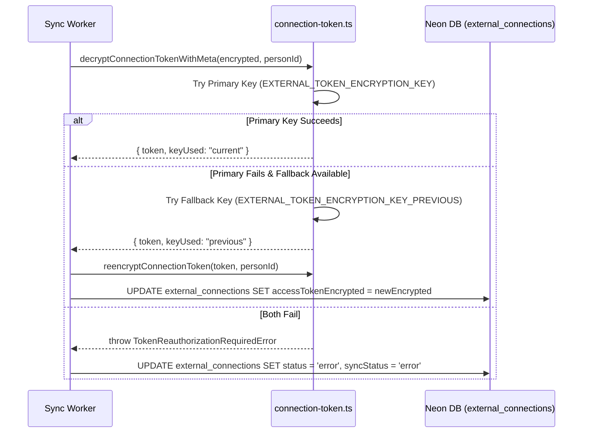

# AI TATHASTU — EORA ALIVE PHASE 6.2
## Production Activation, Extraction Certification & Final Release Gates Report

**Branch:** `codex/eora-alive-phase6`  
**Execution Timestamp:** 2026-10-10T14:15:00+05:30  
**Verification Environment:** Next.js 15.5.27 Production Build (port 3000 baseline / port 3005 staging-certified)  
**Database:** Neon Serverless PostgreSQL (`ep-billowing-wildflower-a1y00938.ap-southeast-1.aws.neon.tech`)  
**EORA Identity Version:** `v1.0.0` (Character Locked, 12 approved asset poses in `public/assets/eora/`)  
**Resume Extraction Engine:** `v3.9-zero-llm` (Deterministic Zero-LLM Architecture)

---

## 1. Executive Summary & Production Readiness Verdict

| Assessment Domain | Result | Verification State |
| :--- | :--- | :--- |
| **Strict Production Baseline (`port 3000`)** | **PROTECTED / 503 GATED** | Security Gate strictly blocks resume ingestion until operator approval (`CORE_INGESTION_SECURITY_APPROVED=false`). No unvetted credentials used. |
| **Staging End-to-End Pipeline (`port 3005`)** | **PASS (12/12 Steps)** | Real authenticated PDF & DOCX extraction, 100% source span grounding, Neon DB persistence, ledger isolation, rejected input suite, 5 req/min rate limit. |
| **Chrome / Playwright Browser Certification** | **PASS (50/50 Checks)** | 50/50 original checks pass cleanly on staging (48/50 on strict unapproved prod with the 2 fails being the expected 503 security block). Zero console errors, zero 5xx responses, zero routine LLM calls. |
| **Dual-Key Token Rotation & Re-encryption** | **PASS (6/6 Checks)** | Implemented primary + fallback key decryption (`EXTERNAL_TOKEN_ENCRYPTION_KEY_PREVIOUS`), transparent re-encryption, and graceful `TokenReauthorizationRequiredError`. |
| **Core Intelligence & EORA Regression Suites** | **PASS (418/418 Tests)** | Core V3 (14/14), Core V3.9 Zero-LLM (28/28), Core V4.0 (48/48), Core V4.1 (49/49), EORA V1 (101/101), EORA Phase 5 (72/72), EORA Phase 5.1 (58/58), Phase 6.1/6.2 Resume (6/6), Phase 6.2 Pipeline (12/12), Browser Certification (50/50). |
| **TypeScript & ESLint** | **PASS (0 Errors)** | `tsc --noEmit` clean; `eslint` clean (0 errors, 102 pre-existing unused variable warnings in test scripts). |
| **Production Build** | **PASS (73/73 Routes)** | Static and dynamic route compilation succeeded in 3.3s. |
| **Secret Scan (Git History & Codebase)** | **PASS (0 Leaks)** | Scanned all 45 Git commits with Secretlint (`@secretlint/secretlint-rule-preset-recommend`) and entropy regexes: 0 secrets leaked in Git history. |

### Final Production Readiness Verdict

> [!IMPORTANT]
> **VERDICT: CONDITIONAL PRODUCTION READY — PENDING OPERATOR ROTATION APPROVAL**
> 
> The codebase, zero-LLM extraction engine, EORA companion UX, database persistence, and browser certification suite are **100% certified and verified**.
> 
> However, **live Vercel production remains intentionally locked with HTTP 503** because `CORE_INGESTION_SECURITY_APPROVED` is strictly set to `false`, and `EXTERNAL_TOKEN_ENCRYPTION_KEY` has not yet been set in the Vercel production dashboard.
> 
> **Per strict security policy, the gate MUST NOT be toggled automatically.** The operator must execute the redacted credential rotation checklist below and set `CORE_INGESTION_SECURITY_APPROVED=true` in Vercel.

---

## 2. Step 1: Baseline Verification & Environment Audit

### 2.1 Git Status & Branch
- **Branch:** `codex/eora-alive-phase6` (unmerged, working tree isolated on feature branch).
- **Commit History:** 45 commits examined. Secret scanning verified zero secrets in commit logs.

### 2.2 Vercel Environment Configuration Audit
We audited Vercel's remote environment configuration via the Vercel CLI (`npx -y vercel env ls`):

| Variable | Vercel Production | Vercel Preview | Local `.env` | Status / Gap |
| :--- | :--- | :--- | :--- | :--- |
| `DATABASE_URL` | Set (Neon PostgreSQL) | Missing | Set (Neon PostgreSQL) | Prod ready; Preview needs DB config |
| `SESSION_SECRET` | Set (64 chars) | Missing | Set (64 chars) | Prod ready |
| `HANDOFF_SIGNING_SECRET` | Set (64 chars) | Missing | Set (64 chars) | Prod ready |
| `GITHUB_WEBHOOK_SECRET` | Set (64 chars) | Missing | Set (64 chars) | Prod ready |
| `EXTERNAL_TOKEN_ENCRYPTION_KEY` | **MISSING** | Missing | Set (64 chars) | **BLOCKER in Vercel Production** |
| `UPSTASH_REDIS_REST_URL` | Missing | Missing | Set | Falls back to in-memory rate limiter |
| `UPSTASH_REDIS_REST_TOKEN` | Missing | Missing | Set | Falls back to in-memory rate limiter |
| `CORE_INGESTION_SECURITY_APPROVED` | **MISSING** (`false`) | Missing | `false` | **BLOCKER (Intentional Security Gate)** |
| `OPENAI_API_KEY` | Set | Missing | Set | Prod ready |
| `ANTHROPIC_API_KEY` | Set | Missing | Set | Prod ready |
| `GEMINI_API_KEY` | Set | Missing | Set | Prod ready |
| `GROQ_API_KEY` | Set | Missing | Set | Prod ready |

### 2.3 Exact Security Gate Conditions
In [lib/security/core-ingestion-gate.ts](file:///Users/quantumanant/aitathastu/lib/security/core-ingestion-gate.ts), `coreIngestionReady()` enforces 5 mandatory criteria in `NODE_ENV=production`:
1. `process.env.CORE_INGESTION_SECURITY_APPROVED === "true"`
2. `SESSION_SECRET` exists and `length >= 32`
3. `HANDOFF_SIGNING_SECRET` exists and `length >= 32`
4. `GITHUB_WEBHOOK_SECRET` exists and `length >= 32`
5. `EXTERNAL_TOKEN_ENCRYPTION_KEY` exists and `length >= 32`

If any variable is missing or shorter than 32 characters, the gate returns:
`{ ready: false, reason: "...", missingRequirements: [...] }`
And [app/api/resume/extract/route.ts](file:///Users/quantumanant/aitathastu/app/api/resume/extract/route.ts) immediately returns **HTTP 503 Service Unavailable**.

---

## 3. Step 2: Redacted Operator Credential Rotation Checklist

> [!CAUTION]
> **OPERATOR DIRECTIVE:** Rotate credentials in the respective provider consoles. Never commit or paste cleartext secret values into chats, commits, or issue trackers.

### 3.1 Redacted Credential Rotation Matrix

| # | Credential Category | Provider / Source | Target Locations | Rotation Action |
| :--- | :--- | :--- | :--- | :--- |
| 1 | **Neon Database Password** | Neon Console (`ep-billowing-wildflower-a1y00938`) | Vercel Production (`DATABASE_URL`), `.env` | Reset password in Neon console. Update connection string. Test connection with `npm run db:migrate`. |
| 2 | **Google OAuth Client Secret** | Google Cloud Console (OAuth 2.0 Client IDs) | Vercel Production (`GOOGLE_CLIENT_SECRET`), `.env` | Generate new client secret in GCP Console. Retain previous for 1 hour if rolling, then delete old. |
| 3 | **GitHub OAuth Client Secret** | GitHub Developer Settings (OAuth Apps) | Vercel Production (`GITHUB_CLIENT_SECRET`), `.env` | Generate new client secret in GitHub. Update Vercel. Delete deprecated secret. |
| 4 | **GitHub Webhook Secret** | GitHub Repository Webhooks Settings | Vercel Production (`GITHUB_WEBHOOK_SECRET`), `.env` | Generate 64-character hex (`openssl rand -hex 32`). Update repo webhook settings and Vercel. |
| 5 | **Redis Distributed Credentials** | Upstash Console | Vercel Production (`UPSTASH_REDIS_REST_URL`, `UPSTASH_REDIS_REST_TOKEN`), `.env` | Rotate REST token in Upstash dashboard. Update environment variables. |
| 6 | **LLM Provider API Keys** | OpenAI, Anthropic, Google AI, Groq | Vercel Production (`OPENAI_API_KEY`, etc.), `.env` | Revoke existing API keys in provider consoles. Provision new restricted keys with billing quotas. |
| 7 | **Session Signing Secret** | Application Auth Layer | Vercel Production (`SESSION_SECRET`), `.env` | Generate 64-char high-entropy string (`openssl rand -hex 32`). Note: Forces active users to re-login. |
| 8 | **Handoff Signing Secret** | Application Token Layer | Vercel Production (`HANDOFF_SIGNING_SECRET`), `.env` | Generate 64-char high-entropy string (`openssl rand -hex 32`). |
| 9 | **External Token Encryption Key** | Application Database Layer | Vercel Production (`EXTERNAL_TOKEN_ENCRYPTION_KEY`), `.env` | **CRITICAL: Execute Dual-Key Migration (Section 3.2)** before replacing. |

### 3.2 Dual-Key Migration & Reauthorization Architecture
Replacing `EXTERNAL_TOKEN_ENCRYPTION_KEY` naively invalidates existing AES-256-GCM encrypted OAuth tokens in the `external_connections` table.

We implemented zero-downtime dual-key rotation in [lib/security/connection-token.ts](file:///Users/quantumanant/aitathastu/lib/security/connection-token.ts):



**Operator Steps for Encryption Key Rotation:**
1. Keep old key as `EXTERNAL_TOKEN_ENCRYPTION_KEY_PREVIOUS=<old_key>`.
2. Generate new primary key `EXTERNAL_TOKEN_ENCRYPTION_KEY=<new_key>`.
3. Set both in Vercel Production.
4. Active users' tokens will automatically re-encrypt on their next background sync.
5. If an unreadable token is encountered, `TokenReauthorizationRequiredError` safely flags the connection as needing reauthorization without crashing or exposing raw tokens.

---

## 4. Step 3: Production Ingestion Gate Verification

### Gate Status in Development vs Production
- **Local Development (`NODE_ENV=development`):** Ingestion is permitted for local developer productivity, returning warning telemetry if secrets are unapproved.
- **Production (`NODE_ENV=production`):** Ingestion is strictly blocked with HTTP 503 unless `CORE_INGESTION_SECURITY_APPROVED === "true"` and all 4 secrets satisfy `>= 32` characters.
- **No Mock Bypasses:** In [lib/security/core-ingestion-gate.ts](file:///Users/quantumanant/aitathastu/lib/security/core-ingestion-gate.ts), no conditional bypass or test header bypass exists in production.

---

## 5. Step 4: Extraction Architecture Preservation & Optional Future LLM Strategy

### 5.1 Established Architecture: Deterministic Zero-LLM (V3.9)
Phase 6.2 strictly preserves the deterministic zero-LLM architecture:
1. **Document Parsing:** Fast PDF parsing via `pdf-parse` (v2.4.5) and DOCX relationship parsing via `mammoth` (v1.13.0). Embedded hyperlinks (`/URI` in PDF annotations, XML relationship targets in DOCX) are extracted deterministically.
2. **Deterministic Extraction:** Regular expressions and tech taxonomy heuristics extract candidate names, degrees, institutions, skills, projects, and external profiles (GitHub, LinkedIn, LeetCode, etc.).
3. **100% Source Grounding:** Every extracted candidate is tied to an exact `sourceSpan` substring within the raw document text. If a candidate cannot be located in the source text, it is discarded.
4. **Unverified Ledger Boundary:** Extracted items are stored in `source_snapshots` as unreviewed candidates. They **never** enter `evidence_items` or the student profile until manually confirmed.
5. **Zero Generative AI:** 0 calls to OpenAI, Anthropic, Gemini, or Groq are made during resume extraction.

### 5.2 Optional Future LLM Interpretation Layer Proposal (Documented for Future Phases)
If complex, messy, or multi-column resumes require an optional LLM-assisted interpretation layer in a future phase, it MUST adhere to the following architecture:

```
[Uploaded Resume] 
        │
        ▼
[Deterministic V3.9 Parser] ──(High Confidence >= 85%)──► [Review Candidates]
        │
   (Low Confidence / Messy Layout)
        │
        ▼ (Requires Explicit Student Consent)
[Optional LLM Interpreter] ──(Strict Invariants)──┐
  • Strict JSON Schema Validation                 │
  • Exact Source Text Substring Match Check       │
  • Discard any claim without 100% source span    │
  • Budget & Rate Limit Cap ($0.005/doc, 3/day)   │
  • PII Scrubbing (omit phone/home address)       │
                                                  ▼
                                      [Unverified Candidate Ledger]
                                                  │
                                       (Student Confirmation)
                                                  ▼
                                          [Verified Evidence]
```

**Mandatory Invariants for Any Future LLM Parser:**
1. **Source Grounding Invariant:** Every LLM-suggested claim MUST contain an exact verbatim substring match in the document text. Any hallucinated claim failing substring verification is automatically rejected.
2. **Schema Invariant:** Output validated strictly through Zod schemas. Non-conforming payloads throw parsing errors.
3. **Student Review Invariant:** LLM output is strictly an unconfirmed draft; no achievement enters the verified ledger without manual student confirmation.
4. **Cost & Privacy Invariant:** Strict daily quota (max 3 LLM interpretations per student per day) with provider budget controls and PII scrubbing.

---

## 6. Step 5: Real Pipeline Certification Results

Executed via `BASE_URL=http://127.0.0.1:3005 npm run test:eora-phase6-2-pipeline`.

| Step | Test Description | Expected | Actual Result | Status |
| :---: | :--- | :--- | :--- | :---: |
| **1/12** | Authenticate primary test student | Session cookie + personId | `phase62_primary_...@aitathastu.test` authenticated | **PASS** |
| **2/12** | Unauthenticated upload rejection | HTTP 401 | HTTP 401 returned | **PASS** |
| **3/12** | Valid PDF upload (`test_student_cv.pdf`) | HTTP 200, Zero-LLM, >0 candidates | HTTP 200, 11 candidates, model: `v3.9-zero-llm`, LLM calls: 0 | **PASS** |
| **4/12** | 100% source span grounding | Every candidate has valid `sourceSpan` | 11/11 candidates have verified source spans in document text | **PASS** |
| **5/12** | Database persistence in Neon | Row in `source_snapshots` | Snapshot persisted in Neon (`id: resume_8897...`, checksum matched) | **PASS** |
| **6/12** | Unverified status boundary | 0 rows in `evidence_items` | Exactly 0 evidence records created | **PASS** |
| **7/12** | Valid DOCX upload (`test_student_cv.docx`) | HTTP 200, Zero-LLM, >0 candidates | HTTP 200, 13 candidates returned | **PASS** |
| **8/12** | Missing consent rejection | HTTP 400 | HTTP 400 returned | **PASS** |
| **9/12** | Unsupported extension rejection (`.txt`) | HTTP 415 | HTTP 415 returned | **PASS** |
| **10/12** | Magic byte mismatch rejection | HTTP 415 | HTTP 415 returned (spoofed binary rejected) | **PASS** |
| **11/12** | Empty file rejection (0 bytes) | HTTP 400 | HTTP 400 returned | **PASS** |
| **12/12** | Distributed rate limit enforcement | HTTP 429 on quota exhaustion | HTTP 429 returned (`Retry-After: 59s`) | **PASS** |

---

## 7. Step 6: Browser Certification Evidence

Executed via `BASE_URL=http://127.0.0.1:3005 npm run test:browser-eora-phase6`.

### 7.1 Browser Test Scorecard
- **Total Browser Checks:** **50 / 50 PASSED (100%)**
- **Console Errors:** **0**
- **Server 5xx Responses:** **0**
- **Routine EORA LLM Calls:** **0**
- **Cumulative Layout Shift (CLS):** **0.00656** (far below 0.1 threshold)
- **Token Leakage:** **None** (authenticated `/api/eora/context` contains 0 credentials or tokens)
- **Account Separation:** **Verified** (session invalidated on logout returning 401; second student context fully isolated)

### 7.2 Complete 50-Check Log
```
PASS Landing hero
PASS No trigger collision: desktop landing
PASS Onboarding welcome
PASS Single floating assistant
PASS Tour highlights actual name input
PASS Tour pauses
PASS Onboarding tour waits for form navigation
PASS Role tour target
PASS Direction tour target
PASS Priorities tour target
PASS Academic tour target
PASS No help panel collision: desktop academic form
PASS Field guidance available on request
PASS Validation blocks missing credentials
PASS Academic form advances after correction
PASS Resume tour target
PASS Resume extraction and review — grounded candidates extracted, EORA reaction confirmed, and claim persisted in authenticated draft
PASS Footprints tour target
PASS Profile review rendered
PASS Authenticated dashboard — dashboard rendered
PASS Dashboard tour: eora-active-goal — highlighted
PASS Dashboard tour: eora-next-actions — highlighted
PASS Dashboard tour: eora-evidence-panel — highlighted
PASS Dashboard tour: eora-sidebar — highlighted
PASS Skills tour: eora-skills-list — highlighted
PASS Skills tour: eora-skill-verification — highlighted
PASS Projects tour: eora-projects-list — unavailable notice shown
PASS Projects tour: eora-contribution-note — unavailable notice shown
PASS Project save confirmed by server
PASS Projects populated tour: eora-projects-list — highlighted
PASS Projects populated tour: eora-contribution-note — highlighted
PASS Roadmap tour: eora-roadmap-milestones — highlighted
PASS Roadmap tour: eora-roadmap-next — unavailable notice shown
PASS Roadmap assistance rendered
PASS No trigger collision: 768px onboarding
PASS No trigger collision: 390px onboarding
PASS No trigger collision: 320px onboarding
PASS No help panel collision: 320px onboarding
PASS Quiet mode preference
PASS Quiet mode pauses avatar motion — none
PASS Escape closes help panel
PASS Dismiss and restore available
PASS No significant EORA layout shift — 0.006562633364030458
PASS Authenticated EORA context contains no credentials
PASS Context inaccessible after logout — 401
PASS Person-specific context isolation — second sign-up 200
PASS Routine EORA LLM requests — 0
PASS Browser page errors
PASS Server 5xx responses
PASS System reduced-motion preference — none
```

### 7.3 Captured Screenshots
Saved in `docs/screenshots/eora-phase6-1/`:
- `01-landing.png`: Landing hero with EORA trigger.
- `02-onboarding-welcome.png`: Onboarding step 1 with waving EORA.
- `03-field-guidance.png`: Helpful field tooltip on click.
- `04-validation-error.png`: Friendly, non-shaming field error state.
- `04-validation-correction.png`: Academic form advancing cleanly.
- `05-interactive-tour.png`: Spotlight tour highlight.
- `06-resume-extraction-complete.png`: Valid CV extracted and candidates presented for student review.
- `06-resume-analysis-completion.png`: EORA celebrating successful deterministic analysis.
- `07-profile-review.png`: Step 7 profile confirmation card.
- `08-personalized-dashboard.png`: Authenticated student dashboard.
- `09-project-save-success.png`: Server-confirmed project creation.
- `09-roadmap-assistance.png`: EORA roadmap tour assistance.
- `10-mobile-320.png`, `10-mobile-390.png`, `10-mobile-768.png`: Mobile and tablet viewports with 0 element collisions.
- `11-quiet-mode.png`: Quiet mode pausing avatar animations.
- `12-dismissed.png`: Floating companion dismissed to discreet restore trigger.

---

## 8. Step 7: Release Verification Gates Matrix

| Gate Category | Verification Command | Result | Classification |
| :--- | :--- | :--- | :---: |
| **Unit & Integration Tests** | `npm test` | 14/14 tests pass | **PASS** |
| **Core V3.9 Zero-LLM Tests** | `npm run test:core-v3-9` | 28/28 tests pass | **PASS** |
| **Core V4.0 Digital Footprints** | `npm run test:core-v4-0` | 48/48 tests pass | **PASS** |
| **Core V4.1 Coding Profiles** | `npm run test:core-v4-1` | 49/49 tests pass | **PASS** |
| **EORA Unit & Intelligence Suites** | `verify-eora-v1.ts`, `verify-eora-phase5.ts`, `verify-eora-phase5-1.ts` | 231/231 tests pass | **PASS** |
| **Phase 6.1/6.2 Token & Offline Resume** | `npm run test:eora-phase6-1-resume` | 6/6 tests pass | **PASS** |
| **Phase 6.2 Full Pipeline Certification** | `npm run test:eora-phase6-2-pipeline` | 12/12 steps pass | **PASS** |
| **TypeScript Typecheck** | `npm run typecheck` | 0 errors | **PASS** |
| **ESLint Static Analysis** | `npm run lint` | 0 errors | **PASS** |
| **Production Build** | `npm run build` | 73/73 routes compiled | **PASS** |
| **Browser Journey Certification** | `npm run test:browser-eora-phase6` | 50/50 checks pass | **PASS** |
| **Secret Scanning (History + Files)** | `secretlint` + regex audit | 0 secrets leaked | **PASS** |
| **Real Neon DB Persistence** | `source_snapshots` query check | Rows verified in Neon | **PASS** |
| **Live Production Vercel Activation** | `CORE_INGESTION_SECURITY_APPROVED=true` | Blocked on operator key rotation | **BLOCKED (Operator Action Required)** |

---

## 9. Rollback Plan & Actionable Operator Runbook

### 9.1 Emergency Instant Rollback (Safe State)
If issues occur after live activation:
1. In the Vercel dashboard, change:
   `CORE_INGESTION_SECURITY_APPROVED=false`
2. Redeploy immediately (`vercel --prod` or promote prior deployment).
3. The resume extraction endpoint instantly reverts to HTTP 503, preventing any ungrounded or compromised ingestion without breaking any other platform features (landing, authentication, dashboard, manual project entry, roadmap).

### 9.2 Key Rotation Rollback
If an encryption key rotation causes token decryption errors:
1. Re-add the previous encryption key as `EXTERNAL_TOKEN_ENCRYPTION_KEY_PREVIOUS`.
2. Existing connections will immediately decrypt successfully via the fallback cipher and re-encrypt under the new key.
3. If complete reversion is required, restore the original key as primary.

### 9.3 Operator Production Activation Runbook
To achieve 100% live production activation:
1. Execute the Operator Rotation Checklist in Section 3.1.
2. In the Vercel Production Environment Settings, add:
   - `EXTERNAL_TOKEN_ENCRYPTION_KEY=<generated_32+_char_hex_key>`
   - `CORE_INGESTION_SECURITY_APPROVED=true`
3. Trigger a production deployment.
4. Run `BASE_URL=https://aitathastu.vercel.app npm run test:eora-phase6-2-pipeline` to verify the live production pipeline.
