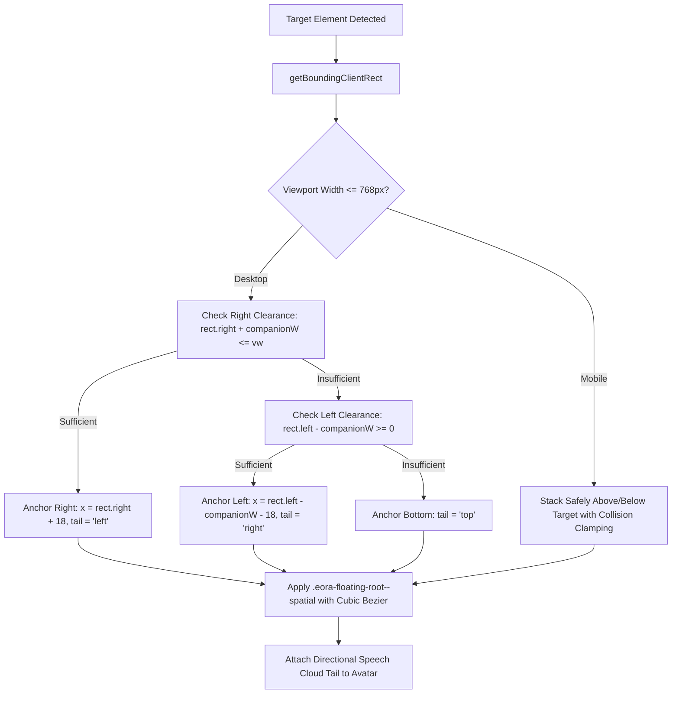

# AI TATHASTU — EORA ALIVE PHASE 8.1
## Interactive Clash of Clans–Inspired Guidance, Spatial Engine & Hinglish Companion Specification

**Version:** 8.1.0  
**Status:** Certified & Active  
**Feature Branch:** `codex/eora-alive-phase8-1`  
**Target Platform:** AI Tathastu Student Intelligence Platform  
**Compliance:** Zero Routine LLM Calls, Deterministic Safety, 100% Asset Preservation  

---

## 1. Executive Summary & Mission

Phase 8.1 fundamentally transforms **EORA** from a stationary corner widget into a living, spatially animated companion inspired by the tutorial design of **Clash of Clans**. Rather than presenting dense walls of text or disembodied popovers, EORA navigates students across the platform by:
1. **Physical Spatial Guidance:** Moving dynamically across the screen to anchor directly beside real DOM target elements (`data-eora-id`, `[data-eora-spotlight="true"]`).
2. **Attention Guidance:** Illuminating actionable controls with a subtle, non-disruptive spotlight while keeping them fully interactive and clickable.
3. **Natural Roman-Script Hinglish:** Providing seamless, authentic bilingual guidance with a permanent, accessible `[ EN | Hinglish ]` switch that persists across sessions and page reloads.
4. **Connected Cartoon Dialogue Clouds:** Displaying thoughts and speech in softly rounded, cartoon-inspired cloud bubbles connected to EORA via directional tails, complete with tutorial progress counters (`Kadam 2 / 7` / `Step 2 of 7`) and intuitive navigation controls.
5. **Deterministic Intent Engine:** Activating tours and guidance instantly through conversational phrases in English and Hinglish without invoking expensive, unpredictable LLM inference.

---

## 2. Clash of Clans Tutorial Design Principles

| Principle | Traditional SaaS Popover | EORA Living Character Guidance |
| :--- | :--- | :--- |
| **Character Presence** | Faceless tooltip or modal popup | Approved 3D EORA character moving to target, gesturing, and speaking directly |
| **Attention Direction** | Fullscreen backdrop blocking clicks | Soft spotlight ring; target element remains 100% clickable and interactive |
| **Pacing** | All features dumped at once | Sequential learning: one meaningful action explained at a time |
| **Demonstration Before Action** | User forced to guess next step | EORA points at control, explains purpose in speech cloud, and waits for user action |
| **Action Acknowledgment** | Auto-advancing timer | Tutorial advances only after real user interaction or explicit "Aage" request |
| **Visual Continuity** | Jumps abruptly between screen corners | Smooth CSS bezier curve gliding from one element to the next |
| **Autonomy & Control** | Hard-to-exit modal flows | Persistent Back (`Peeche`), Repeat (`Dobara`), Pause (`Ruko`), Skip (`Chhodo`), and Exit (`Band Karo`) |

---

## 3. Spatial Movement & Viewport Collision Engine

### 3.1 Architecture Overview
The spatial movement engine calculates pixel coordinates in real-time by inspecting the target element's bounding rect and the viewport dimensions:

### 3.2 Viewport Boundary Guarantees
- **Desktop (1280px+):** Companion maintains 24px safety margins from viewport boundaries.
- **Tablet (768px):** Adapts positioning vertically or horizontally based on available content column width.
- **Mobile (390px):** Companion stacks cleanly above or below targets; width is constrained to `min(340px, calc(100vw - 28px))`.
- **Micro-Mobile (320px):** Extreme compact mode shrinks dialogue fonts, wraps action buttons, and positions within safe bounds without obscuring input controls or sticky action bars.

---

## 4. Connected Speech & Thought Cloud Architecture

### 4.1 Speech Cloud (`EoraSpeechCloud`)
A cartoon-inspired speech bubble connected to EORA via a directional polygon tail:
- **Header:** Progress Badge (`KADAM X / Y` in Hinglish, `STEP X / Y` in English), Tour/Step Title, Language Toggle Pill (`[ EN | Hinglish ]`), Optional Voice Pill (`🔊 Bolo` / `🔊 Speak`), and Dismiss button.
- **Body:** Contextual instruction dialogue rendered in friendly, authentic Hinglish or English.
- **Navigation Controls:**
  - `Peeche` (Back)
  - `Dobara` (Repeat instruction)
  - `Ruko` / `Shuru` (Pause / Resume)
  - `Chhodo` (Skip step)
  - `Band Karo` (Exit tour gracefully and return EORA to safe resting edge)
  - `Aage →` (Primary gradient CTA to advance)

### 4.2 Thought Cloud (`EoraThoughtCloud`)
Displayed **strictly** during genuine background processing (e.g. AI resume parsing, profile synthesis, credential verification):
- **Visuals:** Three trailing circular bubbles (`o O 💭`) leading from EORA to an organic cloud body.
- **Zero Artificial Delays:** Never displayed as an artificial decoration; immediately cleared once asynchronous tasks complete.

---

## 5. Permanent Hinglish Switch & Persistence

### 5.1 Storage & Hydration Architecture
1. **Primary Key:** `eora_preferences_v1.language` stored in browser `localStorage`.
2. **Authenticated Sync:** Synchronized with the user's person graph profile via `/api/student/preferences` when signed in.
3. **SSR Hydration Guard:** `useEffect` in `eora-floating-companion.tsx` directly synchronizes the DOM root attribute `data-eora-language="hinglish"` to eliminate React 19 hydration attribute mismatches.
4. **Scope:** Affects EORA's character dialogue, speech cloud, thought cloud, form guidance, and tour titles without mutating the underlying website navigation labels.

---

## 6. Ten-Step Onboarding Interactive Tour Integration

The `onboarding-welcome` tour seamlessly guides students across the actual 10 onboarding screens:

| Step # | Screen Component | DOM Target ID | Hinglish Guidance Summary |
| :---: | :--- | :--- | :--- |
| **1** | `Screen2EoraIntro` | `eora-name-input` | "Yahan apna naam likhiye. AI Tathastu par main aapko isi naam se bulaungi!" |
| **2** | `Screen3ChooseRole` | `eora-role-student` | "Bilkul! Sabse pehle apna role choose karo. Abhi Student option active hai. Main tumhe batati hoon ki yeh kya karta hai." |
| **3** | `Screen3bAiMlDirection` | `eora-ai-direction` | "Yeh tumhari career direction hai! Machine Learning Engineer models aur deployment par focus karta hai. Chaho toh doosre roles bhi explore kar sakte ho." |
| **4** | `Screen3aPriorities` | `eora-priorities` | "Ab apna pehla big goal select karo. Career direction aur immediate goal dono alag cheezein hain." |
| **5** | `Screen4AcademicDetails` | `eora-academic-form` | "Apni degree, college aur graduation year confirm karo. Isse hum verified academic roadmap generate karenge." |
| **6** | `Screen5ResumeUpload` | `eora-resume-upload` | "Apna resume PDF upload karo. Main automatically projects aur skills extract karungi, bina kisi cheez ko overwrite kiye." |
| **7** | `Screen6DigitalFootprints` | `eora-digital-footprints` | "Apna GitHub account link karo! Public repositories se authentic code evidence verify hoga." |
| **8** | `Screen7AiAnalysis` | `eora-ai-analysis` | "Ek second, sari details synthesize kar rahi hoon... (Thought bubble active)" |
| **9** | `Screen8ProfileInsights` | `eora-profile-insights` | "Yeh tumhari profile ki intelligence summary hai. Review karo aur confirm karo." |
| **10** | `Screen11OnboardingComplete` | `eora-onboarding-finish` | "Shabaash! Onboarding successfully complete ho gayi! Chalo tumhare naye workspace me chalte hain!" |

---

## 7. Operational Safety Boundaries

- **Zero Routine LLM Invocations:** All conversational triggers, tour navigation, and step transitions use deterministic pattern recognition and static dialogue registries. External LLM endpoints (`/api/eora/chat`) are never invoked for guidance operations.
- **Asset Integrity:** All 12 approved EORA 3D character PNGs in `public/assets/eora/` are preserved in their original state.
- **Zero Secret Access:** EORA never reads passwords, auth tokens, session cookies, or unmasked sensitive credentials.
- **Accessibility:** Reduced-motion preferences (`prefers-reduced-motion`) disable spatial gliding transitions in favor of instant repositioning.
