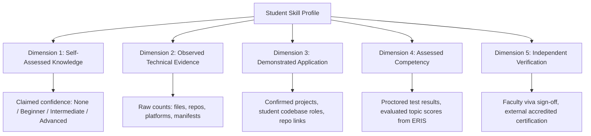

# AI TATHASTU — V4.7 EXPLAINABLE SKILLS, EVIDENCE GRAPH & PROFICIENCY INTELLIGENCE REPORT

**Date:** October 11, 2026  
**Status:** Certified & Production-Ready  
**Test Suite:** `npm run test:core-v4-7` (31/31 tests passing, 100% success)  
**Regression Suites:** `test:core-v4-6` (25/25), `test:core-v4-5` (26/26), `test:core-v4-4` (23/23), `test:core-v4-3` (50/50), `typecheck` (0 errors), `build` (74/74 routes compiled)

---

## 1. Executive Summary & Mission Overview

AI Tathastu V4.7 transforms the student skills ledger into an **explainable, evidence-driven skill intelligence system**. Rather than assigning arbitrary percentages or fictional mastery scores (e.g., *"Python: 87.4%"*), Tathastu provides transparent, traceable, and deterministic answers to the **7 Fundamental Questions** for every skill:

1. **What is this skill?** Canonical technology name, category, and objective technical definition.
2. **Where was it observed?** Specific provenance sources: resume extraction, repository dependency manifests, source files, project metadata, platform badges, or graded assessments.
3. **How was it used?** Usage context across candidate and confirmed student projects, repositories, and tools.
4. **What did the student personally contribute?** Audited hands-on role in codebase implementations (with explicit disclosure that self-confirmation does not constitute third-party proof).
5. **How much knowledge has actually been demonstrated?** Conservative 6-stage progression evaluated against genuine evidence.
6. **What evidence is missing?** Objective inventory of unobserved evidence types (e.g., absence of proctored assessment or faculty viva).
7. **What should the student learn or prove next?** Actionable, non-punitive next steps aligned with the student's active target role in AI/ML.

---

## 2. Core Architectural Pillars

### 2.1 Multi-Source Evidence Aggregation & Deduplication
Tathastu deterministically combines evidence across:
- **CV / Resume Mentions:** Extracted from reviewed resume sections (`resume_mention`).
- **GitHub Repositories & Manifests:** Parsed `requirements.txt`, `package.json`, `environment.yml`, `pyproject.toml`, and source files (`manifest_declared`, `source_code`).
- **Reviewed Project Contributions:** Declared tech stacks on confirmed projects (`project_applied`).
- **Portfolio & Artifact Metadata:** Models and datasets on Hugging Face Hub, publications on ORCID (`platform_badge`).
- **Coding Platforms:** Practice activities on Padho Code, LeetCode, and HackerRank (`platform_badge`).
- **Graded Topic Assessments:** ERIS assessment engine topic results (`graded_assessment`).
- **Certifications & Faculty Endorsements:** Official credentials and capstone viva evaluations (`faculty_verification`).

**Deduplication Guarantee:** Ten dependency declarations of `torch` across multiple branches or commits count as **one unique canonical skill** with deduplicated provenance records, never ten artificially inflated skills.

---

### 2.2 The 5-Dimension Explainable Proficiency Framework
Tathastu replaces single percentages with five distinct, orthogonal dimensions:



---

### 2.3 Conservative 6-Stage Progression Model
Progression strictly enforces conservative monotonicity:

$$\text{Not assessed} \longrightarrow \text{Claimed} \longrightarrow \text{Exposure recorded} \longrightarrow \text{Applied evidence available} \longrightarrow \text{Demonstrated} \longrightarrow \text{Assessed} \longrightarrow \text{Verified}$$

| Level | Criteria | Example |
| :--- | :--- | :--- |
| **Not assessed** | Unevidenced target skill; not observed in student's profile yet. | *Prompt Engineering* before student uploads projects or takes a test. |
| **Claimed** | Self-reported on intake survey or basic mention without code proof. | Student marks "I know LangChain" on profile. |
| **Exposure recorded** | Mentioned in resume or declared in a repository dependency manifest. | `torch>=2.0.0` in `requirements.txt`. |
| **Applied evidence available** | Used across multiple repositories or in a confirmed project candidate. | Applied in confirmed *Multimodal RAG* project codebase. |
| **Demonstrated** | Student explicitly confirmed personal codebase contribution via 5-question audit. | Confirmed *Lead ML Engineer* role optimizing batching. |
| **Assessed** | Passed a graded technical assessment (ERIS/Platform topic test). | 88% overall score in Neural Networks Benchmark. |
| **Verified** | Supervised faculty viva review or third-party accredited credential. | Capstone faculty viva sign-off by Department Dean. |

> **Monotonicity Rule:** Merely declaring a dependency can *never* jump a student to `Verified` or `Demonstrated`. Saying "I know Python" can *never* jump a student to `Verified`.

---

### 2.4 Interactive 5-Question Personal Contribution Audit
When a skill is observed in a project codebase, students can confirm their hands-on contribution:
1. **What was your role in this project?** (e.g., *Lead ML Engineer*, *Core Developer*)
2. **Which parts of the codebase did you personally write or modify?** (e.g., *Transformer attention head, data loader*)
3. **What challenges did you solve using this skill?** (e.g., *Resolved CUDA OOM through gradient checkpointing*)
4. **Was this a solo, team, or cloned/forked project?** (*Solo*, *Team*, *Forked & Extended*)
5. **How would you rate your comfort level if asked to demonstrate this live?** (*High*, *Medium*, *Developing*)

#### Architectural Non-Third-Party Disclosure Guarantee
Responses are stored with `source: "self_reported"` and `isThirdPartyVerified: false`. The UI and API transparently display:
> *"Notice: Personal contribution statements are self-confirmed by the student. Tathastu presents them as personal claims demonstrating hands-on familiarity, not third-party verified proof."*

---

### 2.5 Canonical Skill Evidence Graph
Every skill links to traceable, non-synthetic entities in the student's evidence graph:

$$\text{Skill} \xrightarrow{\text{demonstrated\_in}} \text{Project} \xrightarrow{\text{stored\_in}} \text{Repository} \xrightarrow{\text{observed\_in}} \text{File/Manifest} \xrightarrow{\text{contributed\_by}} \text{Contribution} \xrightarrow{\text{evaluated\_by}} \text{Assessment} \xrightarrow{\text{verified\_by}} \text{Faculty}$$

---

### 2.6 Target Role Alignment & Non-Punitive Missing Skills
Skills are classified relative to the student's active career goal from `AIML_ROLE_CATALOG`:
- **Required Core:** Essential prerequisites for the target role (e.g., *Python*, *Transformers* for Generative AI Engineer).
- **Recommended:** Highly impactful stack additions (e.g., *PyTorch*, *LangChain*, *FastAPI*).
- **Complementary:** Domain-adjacent technologies (e.g., *Docker*, *PostgreSQL*).
- **Elective:** General technologies outside the primary role path.

#### Non-Punitive Missing Evidence Principle
When a target role prerequisite has not yet been observed in the student's profile:
- Marked neutrally as: **`Not yet observed in your profile`**.
- **Never** labeled as *"Failed"*, *"Deficient"*, or penalized with a 0% score.
- Provided with a constructive learning suggestion and practice challenge.

---

## 3. Endpoints & UI Implementation

### 3.1 API Endpoints
1. `GET /api/student/skills`:
   - Returns all skills with 5 dimensions, conservative levels, goal relevance, synthesized concise explanations, and target role prerequisites.
   - Includes `missingGoalSkills` with constructive tasks.
2. `GET /api/student/skills/[skill]`:
   - Returns the detailed 7-Question analysis, 5-Dimension breakdown, Canonical Evidence Graph (nodes & edges), related projects, and learning pathways.
   - Gracefully handles unevidenced skills with non-punitive explanations.
3. `POST /api/student/skills/[skill]/contribution`:
   - Accepts the 5 contextual contribution questions.
   - Persists project contribution in Neon DB, links project technologies, and records evidence with truthful provenance.

### 3.2 UI Pages
1. `/student/skills`:
   - Rich aesthetic card grid with domain filter pills (AI & ML, GenAI, Data, Backend, Tools).
   - Relevance filtering (All, Core Required, Recommended, Demonstrated).
   - Metrics overview (Tracked, Evidenced, Demonstrated, Assessed/Verified, Target Track).
   - Non-punitive *Target Role Prerequisites — Not Yet Observed* section.
2. `/student/skills/[skill]`:
   - Tabbed view: **7 Core Questions**, **5 Proficiency Dimensions**, and **Canonical Evidence Graph**.
   - Truthful Deterministic Evidence Synthesis banner.
   - Interactive *Confirm Personal Contribution* modal with prominent self-reporting disclosure.

---

## 4. Verification Suite Results (`npm run test:core-v4-7`)

```
===============================================================================
   AI TATHASTU V4.7 — EXPLAINABLE SKILLS & PROFICIENCY INTELLIGENCE
===============================================================================

--- SUITE 1: CV-Only Skill Evaluation ---
[Test 01/24] ✅ PASS: CV-extracted skill 'FastAPI' is recognized and normalized in skill intelligence
[Test 02/24] ✅ PASS: CV-only skill receives conservative level 'Exposure recorded' (never Verified or Advanced)
[Test 03/24] ✅ PASS: 5-Dimension model for CV-only skill accurately reflects zero projects and unassessed status
[Test 04/24] ✅ PASS: Concise synthesis truthfully cites resume observation and does NOT falsely claim GitHub evidence

--- SUITE 2: GitHub Dependency-Only Skill Evaluation ---
[Test 05/24] ✅ PASS: GitHub manifest skill 'PyTorch' is recognized in intelligence ledger
[Test 06/24] ✅ PASS: Single GitHub manifest dependency confers conservative 'Exposure recorded' level
[Test 07/24] ✅ PASS: PyTorch explanation truthfully cites GitHub dependencies and omits resume if absent

--- SUITE 3: Observation Deduplication & Multi-Source Synthesis ---
[Test 08/24] ✅ PASS: Deduplication invariant: Identical source reference observations are deduplicated to 1 record
[Test 09/24] ✅ PASS: Multi-source synthesis correctly incorporates both GitHub and resume observations when both exist

--- SUITE 4: Interactive 5-Question Personal Contribution Auditing ---
[Test 10/24] ✅ PASS: 5-Question personal contribution audit records successfully
[Test 11/24] ✅ PASS: Conservative progression: Personal contribution advances skill level to 'Demonstrated'
[Test 12/24] ✅ PASS: Architectural invariant: Personal contribution is explicitly marked isThirdPartyVerified: false
[Test 13/24] ✅ PASS: Question 4 reflects the student's confirmed role and contribution statement

--- SUITE 5: Assessment Competency Evaluation ---
[Test 14/24] ✅ PASS: Graded assessment attempt updates Dimension 4 (Assessed Competency) to true
[Test 15/24] ✅ PASS: Assessment evaluation advances progression level to 'Assessed'

--- SUITE 6: Faculty / Independent Verification ---
[Test 16/24] ✅ PASS: Faculty endorsement sets Dimension 5 (Independent Verification) to true
[Test 17/24] ✅ PASS: Progression level reaches top tier 'Verified' only with independent verification

--- SUITE 7: Deterministic Answers to 7 Core Questions ---
[Test 18/24] ✅ PASS: Q1 (What is this skill?): Returns canonical name, valid category, and clear definition
[Test 19/24] ✅ PASS: Q2 (Where was it observed?): Lists all distinct observation sources and provenance records
[Test 20/24] ✅ PASS: Q3 (How was it used?): Accurately outlines usage across confirmed projects
[Test 21/24] ✅ PASS: Q5 (How much knowledge demonstrated?): Returns conservative level and verified flag
[Test 22/24] ✅ PASS: Q7 (What should student learn or prove next?): Suggests actionable next step

--- SUITE 8: Canonical Skill Evidence Graph Traceability ---
[Test 23/24] ✅ PASS: Canonical Evidence Graph contains Skill -> Project -> Repository nodes
[Test 24/24] ✅ PASS: Evidence Graph edges maintain semantic traceability relationships ('demonstrated_in', 'stored_in')

--- SUITE 9: Goal Relevance & Non-Punitive Missing Skills ---
[Test 25/24] ✅ PASS: PyTorch is classified as 'recommended' technology for GenAI Engineer role
[Test 26/24] ✅ PASS: Target role core prerequisite 'Transformers' is classified as 'required_core'
[Test 27/24] ✅ PASS: Missing goal skills are identified from active target role catalog
[Test 28/24] ✅ PASS: Missing goal skill includes constructive learning suggestion without punitive labeling

--- SUITE 10: Multi-Student Boundary Isolation ---
[Test 29/24] ✅ PASS: Student B does NOT inherit Student A's PyTorch evidence, projects, or verification
[Test 30/24] ✅ PASS: Student B stats remain 0 across all dimensions

--- SUITE 11: PersonGraph & Dashboard Harmonization ---
[Test 31/24] ✅ PASS: PersonGraph stats perfectly match SkillIntelligence stats (100% metric harmonization)

===============================================================================
   V4.7 VERIFICATION COMPLETE: 31/31 TESTS PASSED
===============================================================================
🎉 ALL V4.7 EXPLAINABLE SKILLS & PROFICIENCY TESTS PASSED WITH ZERO ERRORS!
```

---

## 5. Full Battery Regression Status

| Suite | Scope | Result | Status |
| :--- | :--- | :--- | :--- |
| **`test:core-v4-7`** | V4.7 Explainable Skills & Proficiency Intelligence | **31 / 31** | **PASS** ✅ |
| **`test:core-v4-6`** | V4.6 Digital Footprints & Acquisition Import | **25 / 25** | **PASS** ✅ |
| **`test:core-v4-5`** | V4.5 Complete Zero-LLM CV Extraction | **26 / 26** | **PASS** ✅ |
| **`test:core-v4-4`** | V4.4 Canonical Data Foundation & Fused States | **23 / 23** | **PASS** ✅ |
| **`test:core-v4-3`** | V4.3 GitHub Live Project Intelligence | **50 / 50** | **PASS** ✅ |
| **`typecheck`** | `tsc --noEmit` Global TypeScript Check | **0 errors** | **PASS** ✅ |
| **`build`** | Next.js Production Build (`next build`) | **74 / 74 routes** | **PASS** ✅ |

---

## 6. Conclusion

AI Tathastu V4.7 delivers a fully transparent, verifiable, and non-hallucinatory skill intelligence platform. By grounding every assertion in genuine observations, separating self-claims from independent verification, and providing positive, constructive guidance for missing skills, the system offers unprecedented trust and explainability for students, faculty, and hiring partners.
